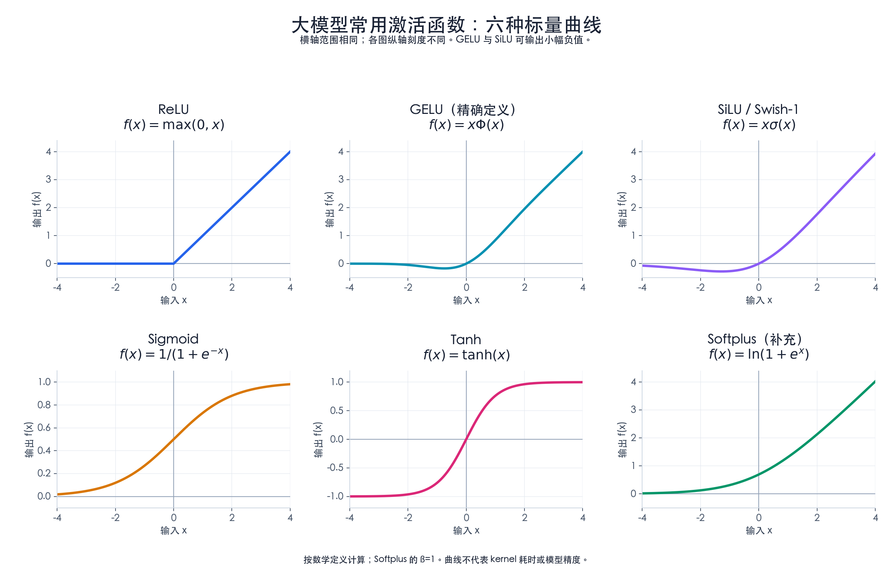
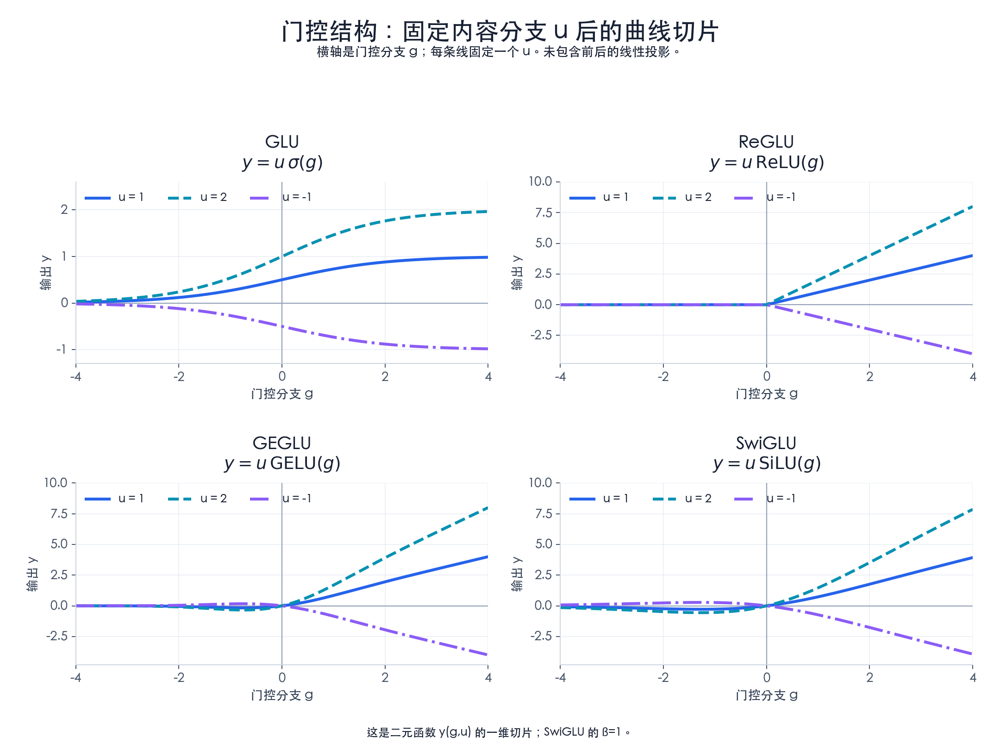
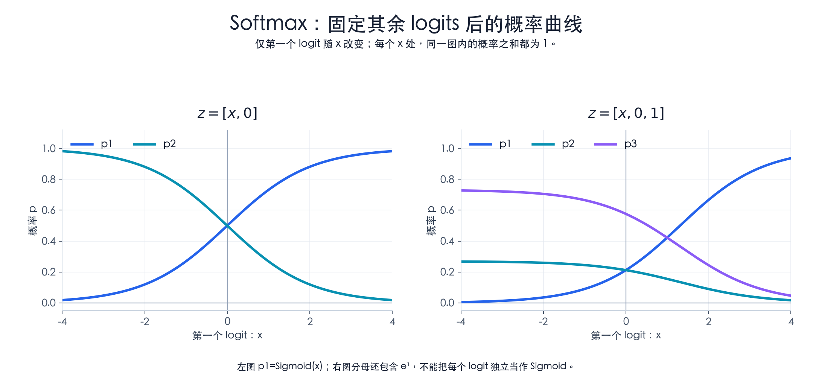

# 大模型常用激活函数：作用、公式与曲线

整理日期：2026-10-05。

## 1. 激活函数解决什么问题

**激活函数（Activation Function）把线性计算的结果再做一次非线性变换，使网络可以表达更复杂的关系。**最简单的例子是 ReLU：负数变成 0，非负数保持原值。

例如，前馈网络 FFN（Feed-Forward Network）可写为：

$$
\operatorname{FFN}(x)=f(xW_1+b_1)W_2+b_2
$$

其中 $W_1,W_2$ 是学习得到的权重，$b_1,b_2$ 是偏置，$f$ 是激活函数。如果去掉中间的非线性变换，两个线性层连同偏置仍可合并成一个仿射变换：

$$
(xW_1+b_1)W_2+b_2=x(W_1W_2)+(b_1W_2+b_2)
$$

这是关于这段 FFN 的代数推导；完整 Transformer 还包含 Attention、归一化等其他操作。

学习大模型实现时，应区分三种对象：

| 对象 | 本文覆盖 | 用来做什么 |
| --- | --- | --- |
| 逐元素非线性函数 | ReLU、GELU、SiLU/Swish、Sigmoid、Tanh；补充 Softplus | 变换特征、生成门控系数或满足正值约束 |
| 门控组合结构 | GLU、ReGLU、GEGLU、SwiGLU | 让一条分支调节另一条分支的内容 |
| 沿指定维度归一化的向量函数 | Softmax | 将一组分数转换成总和为 1 的权重 |

ReLU、GELU、SiLU 与 SwiGLU 是理解 FFN 的主线。Sigmoid、Tanh 用于理解门控与有界变换；Softplus 用于正值参数化。它们在模型中的作用和使用频率并不相同。

“激活函数”与“激活张量”也不同：前者是计算规则，后者通常指模型运行中产生的中间数据。显存报告中的 activation memory 不只包含激活函数的输出。

## 2. 六种标量函数及其曲线

以下函数对一个实数 $x$ 产生一个实数输出。应用到张量时，通常逐元素计算，形状保持不变。图中所有横轴都是 $[-4,4]$，不同子图使用适合自己的纵轴范围。

矢量版：[六种标量函数 SVG](assets/activation-functions/scalar-activation-curves.svg)。

### 2.1 ReLU：负数截断，正数通过

ReLU 全称 Rectified Linear Unit，常译为修正线性单元。

$$
\operatorname{ReLU}(x)=\max(0,x)=
\begin{cases}
0,&x<0\\
x,&x\ge 0
\end{cases}
$$

直观上，它是一个由输入符号决定的开关。曲线在负半轴贴着横轴，正半轴沿直线 $y=x$ 上升。

- **作用**：为 FFN 等计算引入非线性，并让部分输出恰好为零。
- **性质**：分段线性，但整体是非线性函数；在 0 处有折点。
- **训练含义**：负半轴导数为 0；如果一个单元长期落在负半轴，相关梯度更新可能受阻。
- **例子**：$[-2,0,3]\mapsto[0,0,3]$。

公式依据：[PyTorch ReLU](https://docs.pytorch.org/docs/2.14/generated/torch.nn.ReLU.html)。曲线和梯度性质由公式直接推出。

### 2.2 GELU：按输入大小平滑地加权

GELU 全称 Gaussian Error Linear Unit，高斯误差线性单元。

$$
\operatorname{GELU}(x)=x\Phi(x)
=\frac{x}{2}\left(1+\operatorname{erf}\left(\frac{x}{\sqrt{2}}\right)\right)
$$

$\Phi(x)$ 是标准正态分布的累积分布函数，表示标准正态随机变量不大于 $x$ 的概率；$\operatorname{erf}$ 是误差函数。这里用这个概率值作为确定性的权重，**计算 GELU 并不需要随机采样**。

- **作用**：在 FFN 中对特征做平滑的非线性变换。
- **如何理解**：较大的正输入得到接近 1 的权重；很负的输入得到接近 0 的权重。
- **曲线特点**：正侧逐渐接近 $y=x$，负侧有一个浅凹谷，之后从负方向趋近 0。它不是处处单调的。
- **例子**：$\operatorname{GELU}(-1)\approx-0.1587$，$\operatorname{GELU}(1)\approx0.8413$。负数不会全部被截成零。

常见的 tanh 近似为：

$$
\operatorname{GELU}(x)
\approx\frac{x}{2}\left[
1+\tanh\left(\sqrt{\frac{2}{\pi}}(x+0.044715x^3)\right)
\right]
$$

这与上面的精确定义应作为不同实现选择记录。图中绘制的是精确定义的数值计算，不是 tanh 近似；近似是否更快还取决于具体 kernel 和硬件。

来源：[GELU 原论文，arXiv v5](https://arxiv.org/abs/1606.08415v5)、[PyTorch GELU 的两种计算方式](https://docs.pytorch.org/docs/2.14/generated/torch.nn.GELU.html)。

### 2.3 SiLU / Swish：输入乘以自己的 Sigmoid

SiLU 全称 Sigmoid Linear Unit。

$$
\sigma(x)=\frac{1}{1+e^{-x}},
\qquad
\operatorname{SiLU}(x)=x\sigma(x)=\frac{x}{1+e^{-x}}
$$

更一般的 Swish 可以写为：

$$
\operatorname{Swish}_{\beta}(x)=x\sigma(\beta x)
$$

**SiLU 对应 $\beta=1$ 的 Swish。**讨论带参数的 Swish 时，需要保留 $\beta$。

- **作用**：平滑地调节特征；它也是常见 SwiGLU 门控结构内部使用的函数。
- **如何理解**：Sigmoid 根据当前输入生成一个系数，再用它缩放该输入。
- **曲线特点**：平滑，负侧有浅凹谷，正侧逐渐接近 $y=x$；与 GELU 形似，但公式和数值不同。
- **例子**：$\operatorname{SiLU}(-1)\approx-0.2689$，$\operatorname{SiLU}(1)\approx0.7311$。

Sigmoid 的系数在 $(0,1)$，但 SiLU 的最终输出还乘了 $x$，因此输出可以为负，也可以大于 1。

来源：[PyTorch SiLU](https://docs.pytorch.org/docs/2.14/generated/torch.nn.SiLU.html)、[GLU Variants 中的 Swish 定义](https://arxiv.org/html/2002.05202v1)。

### 2.4 Sigmoid：把实数压到 0 与 1 之间

本文的 Sigmoid 指 logistic sigmoid：

$$
\sigma(x)=\frac{1}{1+e^{-x}}
$$

- **作用**：生成软门控系数；在恰当的模型与损失定义下，也可表达一个二分类概率。
- **曲线特点**：单调的 S 形，$\sigma(0)=0.5$；输入很负时接近 0，很正时接近 1。
- **训练含义**：两端趋于平坦，导数趋近 0，这称为饱和。
- **例子**：$\sigma(-2)\approx0.1192$，$\sigma(2)\approx0.8808$。

如果内容值为 $u=4$，门控输入为 $g=2$，那么 $u\sigma(g)\approx3.5232$。这可以理解为让内容以约 88% 的比例通过。

来源：[PyTorch Sigmoid](https://docs.pytorch.org/docs/2.14/generated/torch.nn.Sigmoid.html)。门控例子为自行计算。

### 2.5 Tanh：保留正负方向，压到 -1 与 1 之间

Tanh 是双曲正切函数：

$$
\tanh(x)=\frac{e^x-e^{-x}}{e^x+e^{-x}}
$$

- **作用**：生成有界、可正可负的特征；也常用于理解循环网络中的候选状态变换。
- **曲线特点**：以原点为中心的 S 形，$\tanh(0)=0$，数学输出范围为 $(-1,1)$。
- **与 Sigmoid 的区别**：Tanh 可输出负值；Sigmoid 输出非负系数。两者在输入绝对值很大时都饱和。
- **例子**：$\tanh(-1)\approx-0.7616$，$\tanh(1)\approx0.7616$。

两者有代数关系 $\tanh(x)=2\sigma(2x)-1$。Tanh 在本文是理解有界激活的补充，不表示它是当前 Transformer FFN 的默认选择。

来源：[PyTorch Tanh](https://docs.pytorch.org/docs/2.14/generated/torch.nn.Tanh.html)。

### 2.6 Softplus：平滑地生成正值

默认 $\beta=1$：

$$
\operatorname{Softplus}(x)=\ln(1+e^x)
$$

更一般的形式是 $\operatorname{Softplus}_{\beta}(x)=\ln(1+e^{\beta x})/\beta$，其中 $\beta>0$。

- **作用**：将任意实数映射为正值，例如用来参数化要求为正的步长。
- **曲线特点**：平滑、单调递增；负侧趋近 0，正侧接近 $y=x$，在 0 处取 $\ln2\approx0.6931$。
- **与 ReLU 的区别**：有限实数输入下，数学上的 Softplus 总是大于 0，没有 ReLU 的硬截断。
- **例子**：$\operatorname{Softplus}(-1)\approx0.3133$，$\operatorname{Softplus}(1)\approx1.3133$。

在 $\beta=1$ 时，它的导数正好是 Sigmoid。它与 Softmax 名字相近，作用不同。数值实现应避免直接计算很大的 $e^x$；PyTorch 会在阈值以上使用线性分支。图中采用稳定的等价数值计算。

来源：[PyTorch Softplus](https://docs.pytorch.org/docs/2.14/generated/torch.nn.Softplus.html)。大模型相关的具体例子是 [Mamba 论文 v2](https://arxiv.org/html/2312.00752v2) 中用 Softplus 参数化离散化步长 $\Delta$。

### 2.7 同一组输入的数值对比

以下按数学定义计算，保留四位小数：

| 函数 | $x=-2$ | $x=-1$ | $x=0$ | $x=1$ | $x=2$ |
| --- | ---: | ---: | ---: | ---: | ---: |
| ReLU | 0.0000 | 0.0000 | 0.0000 | 1.0000 | 2.0000 |
| GELU | -0.0455 | -0.1587 | 0.0000 | 0.8413 | 1.9545 |
| SiLU | -0.2384 | -0.2689 | 0.0000 | 0.7311 | 1.7616 |
| Sigmoid | 0.1192 | 0.2689 | 0.5000 | 0.7311 | 0.8808 |
| Tanh | -0.9640 | -0.7616 | 0.0000 | 0.7616 | 0.9640 |
| Softplus | 0.1269 | 0.3133 | 0.6931 | 1.3133 | 2.1269 |

## 3. GLU、ReGLU、GEGLU、SwiGLU 是门控组合结构

### 3.1 为什么有两条分支

设同一个输入 $x$ 经过两组线性投影，得到：

$$
g=xW_g+b_g,\qquad u=xW_u+b_u
$$

$g$ 是门控分支的输入，$u$ 是内容分支。对门控分支应用函数，再与内容逐元素相乘：

$$
h=f(g)\odot u
$$

$\odot$ 表示逐元素乘法。每个位置的内容由对应位置的门控结果调节；这不同于对一个张量直接执行单独的 SiLU 或 GELU。

| 结构 | 门控组合公式 | 解释 |
| --- | --- | --- |
| GLU | $h=\sigma(g)\odot u$ | 用 $(0,1)$ 内的系数缩放内容 |
| ReGLU | $h=\operatorname{ReLU}(g)\odot u$ | 负门控输入关闭该位置，正输入产生可大于 1 的系数 |
| GEGLU | $h=\operatorname{GELU}(g)\odot u$ | 用 GELU 形成平滑的门控 |
| SwiGLU | $h=\operatorname{SiLU}(g)\odot u$ | 使用 Swish-1，即 SiLU，形成平滑门控 |

这些定义见 [GLU Variants Improve Transformer，v1](https://arxiv.org/html/2002.05202v1)。本文 SwiGLU 固定 $\beta=1$。PyTorch 的 [GLU 接口](https://docs.pytorch.org/docs/2.14/generated/torch.nn.GLU.html) 使用“内容在前、门控在后”的两半输入；接口参数顺序需要与本文符号对应，不能仅按变量名猜测。

注意，GEGLU 与 SwiGLU 的门控系数可以为负或大于 1。“门”在这里表示调节内容，不只表示 0 到 1 的通过比例。

### 3.2 门控结构的曲线应该怎么画

标量版本是一个二元函数 $y(g,u)=f(g)u$。如果没有固定另一条分支，就没有唯一的二维平面曲线。

下面分别固定 $u=1,2,-1$，横轴只改变 $g$，绘制曲线切片；没有把 $g$ 与 $u$ 假设为同一个输入，也没有包含前后的线性投影。

矢量版：[门控结构 SVG](assets/activation-functions/gated-activation-curves.svg)。

取 $g=1,u=2$，四种结构分别给出：

| 结构 | 输出 |
| --- | ---: |
| GLU | $2\sigma(1)\approx1.4621$ |
| ReGLU | $2\operatorname{ReLU}(1)=2$ |
| GEGLU | $2\operatorname{GELU}(1)\approx1.6827$ |
| SwiGLU | $2\operatorname{SiLU}(1)\approx1.4621$ |

GLU 与 SwiGLU 在这个例子恰好相等，是因为 $g=1$；它们不是同一个函数。例如 $g=2,u=2$ 时，GLU 约为 1.7616，SwiGLU 约为 3.5232。

### 3.3 完整的 SwiGLU FFN

为突出结构，省略偏置：

$$
\operatorname{FFN}_{\mathrm{SwiGLU}}(x)
=\left[\operatorname{SiLU}(xW_g)\odot(xW_u)\right]W_d
$$

若 $x$ 的形状为 $[T,d]$，中间宽度为 $m$：

$$
W_g,W_u\in\mathbb{R}^{d\times m},\qquad
W_d\in\mathbb{R}^{m\times d}
$$

模型原语可以表达为“两次输入投影 → 一次 SiLU → 逐元素乘法 → 输出投影”。实现层可以融合操作或合并投影，原语数量不等于 kernel 启动次数。原始 [LLaMA 论文 v1](https://arxiv.org/html/2302.13971v1) 明确采用 SwiGLU。

同样的中间宽度下，普通两矩阵 FFN 的权重数为 $2dm$，上述门控 FFN 为 $3dm$。公平比较时应按实际中间宽度计算，不能仅把 ReLU 的耗时替换为 SiLU 的耗时就认为完成了 SwiGLU 建模。这里的计数是忽略偏置的代数推导。

## 4. Softmax：沿一个维度把一组分数变成权重

Softmax 接收一个向量，而不是独立地变换每个元素：

$$
p_i=\operatorname{Softmax}(z)_i
=\frac{e^{z_i}}{\sum_{j=1}^{n}e^{z_j}}
$$

这里 $z_i$ 常称为 logit，即尚未归一化的分数。对有限实数输入且 $n>1$，数学上有 $0<p_i<1$，且 $\sum_i p_i=1$。

- **作用**：在 Attention 中生成归一化权重，在词表输出等场景中形成概率分布。
- **直观解释**：提高某个分数不仅改变它自己的输出，也改变其他分数对应的输出，因为大家共享同一个分母。
- **例子**：$\operatorname{Softmax}([1,2,3])\approx[0.0900,0.2447,0.6652]$。
- **与 Sigmoid 的区别**：逐元素 Sigmoid 不保证整组输出和为 1；Softmax 明确让组内输出共同归一化。

计算时通常先减去最大值：

$$
m=\max_j z_j,\qquad
p_i=\frac{e^{z_i-m}}{\sum_j e^{z_j-m}}
$$

这在数学上不改变结果，但能避免指数溢出。必须说明归一化沿哪一个维度进行。Attention 的 mask 还会排除部分位置，因此不能把无 mask 的示例直接当作所有 Attention 实现的完整定义。

来源：[PyTorch Softmax](https://docs.pytorch.org/docs/2.14/generated/torch.nn.Softmax.html)。减最大值的等价性与后面的曲线切片为数学推导。

### 4.1 Softmax 没有唯一的一条标量曲线

左图固定输入为 $z=[x,0]$；右图固定输入为 $z=[x,0,1]$。只改变第一个 logit，其余值保持不变：

矢量版：[Softmax SVG](assets/activation-functions/softmax-curves.svg)。

左图第一项恰好为 $\sigma(x)$，第二项为 $1-\sigma(x)$。更一般地，两类 Softmax 的第一项为 $\sigma(z_1-z_2)$。右图是三类分布，不能把各项分别计算 Sigmoid 来代替。

## 5. 与模型原语、分片和融合的关系

### 5.1 逐元素不代表能穿过归约

ReLU、GELU、SiLU 等是逐元素函数：如果各卡持有不同位置的完整输入元素，各卡可以分别执行。但如果各卡持有的是同一个元素的局部求和贡献，就不能直接对贡献分别应用非线性，再假定求和后仍等价。

例如 $a=2,b=-3$：

$$
\operatorname{ReLU}(a+b)=0,\qquad
\operatorname{ReLU}(a)+\operatorname{ReLU}(b)=2
$$

因此，对待求和的 Partial 布局，需要保留正确的归约与激活顺序，或者使用有明确等价性依据的分布式算法。

### 5.2 Softmax 需要看切分维度

如果不同 Rank 持有不同的完整行，可以各自做行内 Softmax；如果同一行的归一化维被分散到多个 Rank，就需要跨 Rank 合并必要统计量，或采用正确的分布式 Softmax/Attention 算法。不能把 Softmax 当成普通逐元素函数来传播任意分片。

### 5.3 语义与 kernel 实现分开

在拟设计的模型语义层，ReLU、SiLU、逐元素乘法等可以作为原语，SwiGLU FFN 可以作为保留这些子操作的高层区域。执行计划再选择分离执行或融合实现。

融合可能减少中间结果的写回和 kernel 启动，但是否更快、需要多少显存，取决于具体形状、精度、硬件、workspace 和实现；不能用函数曲线的复杂程度直接推断运行时间。GELU 的精确形式与近似形式，也应在实现选择中明确标记。

激活函数属于模型计算定义的一部分，已经训练好的模型不能只为了性能随意把 GELU 换成 ReLU，再假定模型效果不变。函数替换与已知误差范围内的数值近似，应分别评估。

## 6. 图表复现与证据范围

曲线由 [绘图脚本](assets/activation-functions/plot_activation_functions.py) 按公式生成，PNG 用于笔记内阅读，SVG 用于放大或导出。已有 NumPy、SciPy、Matplotlib 的 Python 环境中可运行：

~~~sh
python Model/assets/activation-functions/plot_activation_functions.py
~~~

本次绘图环境：NumPy 2.3.5、SciPy 1.16.3、Matplotlib 3.10.6。GELU 使用标准正态 CDF，Sigmoid 使用稳定实现，Softplus 使用稳定的 log-add-exp，Softmax 按向量计算。脚本会打印正文中的标量数值表，检查概率归一化及两类 Softmax 与 Sigmoid 的关系。

| 证据类型 | 本文采用的内容 |
| --- | --- |
| 官方 API 定义 | PyTorch 2.14 文档中的激活函数、GLU 与 Softmax 定义 |
| 原论文定义及架构事实 | GELU v5；GLU Variants v1；LLaMA v1；Mamba v2 |
| 数学推导 | 线性层合并、门控参数量、函数性质、布局与非线性的关系 |
| 本地数值计算 | 曲线、示例数值与概率归一化检查 |

本文未读取外部源码或固定源码 commit；引用的是上述版本的论文和文档。本地数值绘图不构成模型训练质量、真机 kernel 耗时或多卡 E2E 的证据。

继续阅读：[常用通信算子与分片布局](../parallel/常用通信算子：语义、数值示例与建模关系.md)、[Attention 结构与 KV Cache](Attention/MHA、GQA、MQA与MLA：结构、KV-Cache和TP切分.md)。
