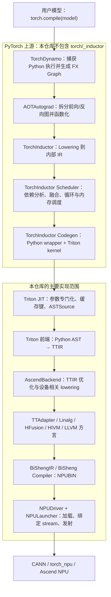

# Inductor 分层实现导读：从 `torch.compile` 到 Ascend NPU 内核

> 基于仓库 `/Users/sky/Code/triton-ascend`，代码快照：`f151685fee1b672852169de6cbf0017df1c3b84c`（`main`）。
>
> 本文的“分层”同时回答两个问题：Inductor 在完整 PyTorch 编译栈中处于什么位置；本仓库从哪一层开始承接 Inductor 生成的程序，又如何将其编译并运行在 Ascend NPU 上。

## 1. 先说结论：本仓库中的 Inductor 到底在哪里

Inductor（通常指 TorchInductor）是 `torch.compile` 默认使用的优化编译器。它接收上游产生的 FX Graph，完成算子分解、布局与内存规划、融合、调度和后端代码生成；对于 GPU/NPU 一类设备，它常把融合后的计算区域生成成 Triton kernel。

但需要明确一个代码边界：

- PyTorch 上游 Inductor 的完整实现通常位于 PyTorch 源码的 `torch/_inductor/`，**本仓库没有这个目录**。
- 本仓库包含完整的 Triton 通用 JIT/编译框架，以及针对 Ascend 的编译器后端、运行时驱动、自动调优和设备相关 MLIR Pass。
- 因此，本仓库在整条 `torch.compile` 链路中主要承接 **Inductor 已经生成的 Triton kernel**，把 Triton AST/TTIR 继续编译为 Ascend NPU 二进制并运行。
- `third_party/ascend/unittest/pytest_ut/test_index_select_inductor.py` 保存了一个典型的 Inductor 风格融合 kernel，但测试本身是直接发射 Triton kernel，并没有在测试进程中调用 `torch.compile`。

可以把二者的关系概括成：

> Inductor 决定“生成什么 kernel、如何融合和调度”；Triton-Ascend 决定“这个 Triton kernel 如何变成 Ascend 可执行内核并被发射”。

## 2. 全链路鸟瞰



从职责上看，这条链可以进一步压缩为五层：

| 层次 | 核心问题 | 主要归属 |
|---|---|---|
| 图捕获层 | 如何把动态 Python 模型变成可编译图？ | TorchDynamo，PyTorch 上游 |
| 图编译层 | 如何分解、融合并调度张量计算？ | AOTAutograd + TorchInductor，PyTorch 上游 |
| Kernel 生成层 | 如何把融合计算表达为 Triton kernel？ | TorchInductor codegen；产物由本仓承接 |
| 设备编译层 | 如何把 Triton kernel 降到 Ascend 二进制？ | 本仓 Triton core + Ascend backend |
| 运行时层 | 如何加载二进制、选择设备/stream 并启动？ | 本仓 Ascend driver + CANN/torch_npu |

## 3. 第 0 层：用户入口与编译边界

典型用户入口是：

```python
optimized_model = torch.compile(model)
output = optimized_model(*inputs)
```

这里需要区分两个编译时刻：

1. `torch.compile` 的图级编译：捕获 FX Graph，让 Inductor 决定融合、调度和 kernel 形态。
2. Triton kernel 的 JIT 编译：第一次遇到某组参数类型、常量和编译选项时，将具体 kernel 编译为设备二进制。

前者生成和组织 kernel，后者编译单个 kernel。二者都有缓存，也都可能因 shape、dtype、stride、常量或配置变化而产生新的专门化版本。

## 4. 第 1 层：TorchDynamo 图捕获（上游层）

TorchDynamo 位于 Python 执行与编译器之间。它观察 Python frame，把可支持的 PyTorch 运算捕获成 FX Graph，并为影响正确性的条件建立 guard，例如输入类型、shape/stride、全局状态等。

这一层的关键产物是：

- 一个或多个 FX Graph；
- 对应的 Python fallback/graph break 边界；
- 用来判断已编译结果能否复用的 guard。

这一层尚不关心 Ascend 的 TTIR、Linalg 或 CANN。若问题表现为“没有进入编译”“graph break 过多”“输入稍变就重编译”，通常先从这一层定位，而不是从 Triton-Ascend 后端定位。

## 5. 第 2 层：AOTAutograd 与图规范化（上游层）

AOTAutograd 负责把训练语义转换为更适合编译的图，典型工作包括：

- 对前向和反向计算进行图级组织；
- 函数化 mutation/view 等语义，使图更接近纯函数；
- 通过 decomposition 把复杂 ATen 算子拆成后端更容易处理的基本算子；
- 保存反向需要的中间量，并形成可独立编译的图。

这层决定 Inductor 最终看到的图形态。一个算子是否被分解、是否 fallback，往往会直接影响后续能否融合成 Triton kernel。

## 6. 第 3 层：Inductor IR、融合与调度（上游层）

Inductor 接收规范化后的 FX Graph，将节点 lowering 成自己的内部表示，并完成几类核心工作：

### 6.1 Lowering

ATen/Prims 节点被转换为更显式的循环、索引和缓冲区语义。此时编译器开始关心：

- 每个输出元素的索引表达式；
- reduction 轴与 pointwise 轴；
- 输入/输出布局和 stride；
- 哪些中间结果可以不落全局内存；
- 哪些节点必须调用外部库或 fallback。

### 6.2 依赖分析与融合

Scheduler 基于读写依赖决定融合边界。融合的核心收益是减少中间张量物化和 kernel launch；融合边界同时受数据依赖、mutation、设备能力、资源约束和代码生成能力限制。

### 6.3 循环与内存调度

Inductor 为融合后的节点选择迭代域、分块方式、reduction 策略和必要的临时缓冲区。对 Triton 后端而言，这些决定会反映为：

- `tl.program_id()` 如何映射到数据块；
- `XBLOCK/YBLOCK/RBLOCK` 等 meta-parameter；
- `tl.arange()` 的向量宽度；
- load/store 的 mask 和地址表达式；
- persistent reduction、split reduction 等 kernel 形态。

### 6.4 Codegen

最终通常生成两类代码：

- Python wrapper：分配输出、检查 guard、调用外部算子、计算 launch grid、依次启动 kernel；
- Triton kernel：描述一个融合区域内部的并行计算。

从本仓库视角看，边界就位于这里：Inductor 生成的 `@triton.jit` 函数开始进入本仓的 Triton JIT 与 Ascend 编译流水线。

## 7. 第 4 层：Triton JIT 与参数专门化（本仓通用层）

主要代码：

- `python/triton/runtime/jit.py`
- `python/triton/compiler/compiler.py`
- `python/triton/backends/__init__.py`
- `python/triton/runtime/driver.py`

### 7.1 `JITFunction.run()`：运行入口

`@triton.jit` 包装后的函数在 `JITFunction.run()` 中：

1. 从活动 driver 获取 device 和 stream；
2. 将实参绑定到 kernel 形参；
3. 根据 dtype、constexpr、对齐/专门化属性和编译选项计算缓存键；
4. 缓存未命中时构造 `ASTSource` 并调用编译器；
5. 将一维到三维 grid 规范化；
6. 使用编译结果的 launcher 发射 kernel。

这个缓存是进程内 JIT kernel cache；它与后面编译产物的文件缓存相互配合。

### 7.2 `ASTSource`：Triton 前端的输入对象

`ASTSource` 封装：

- JITFunction 本体；
- 参数签名；
- `tl.constexpr` 常量；
- 专门化属性；
- 用于缓存失效的源码哈希。

它的 `make_ir()` 调用 `ast_to_ttir()`，把 Triton Python AST 降为 TTIR。也就是说，Inductor 生成的是 Triton Python，而本仓通用前端首先将其转换为 MLIR 体系中的 Triton Dialect。

### 7.3 `compile()`：通用编译流水线编排器

`python/triton/compiler/compiler.py::compile()` 是后续阶段的总编排入口：

1. `driver.active.get_current_target()` 获取当前目标；
2. `make_backend(target)` 选择唯一支持该目标的 backend；
3. backend 解析设备专属选项；
4. 源码、backend、options 和会影响编译的环境变量共同形成文件缓存键；
5. `backend.add_stages()` 注入有序编译阶段；
6. `ASTSource.make_ir()` 生成初始 TTIR；
7. 按顺序执行各 stage，并保存中间 IR/二进制与 JSON metadata；
8. 返回 `CompiledKernel`。

`compile()` 本身不写死 CUDA、AMD 或 Ascend 的 lowering 流程，设备差异通过 backend 插件注入。

### 7.4 Backend/Driver 插件发现

`python/triton/backends/__init__.py` 从 Python entry point 组 `triton.backends` 发现 backend；`setup.py` 将 `ascend` 注册到该组。发现后分别从插件模块加载：

- `compiler.py` 中唯一的 `BaseBackend` 子类；
- `driver.py` 中唯一的 `DriverBase` 子类。

`python/triton/runtime/driver.py` 再从所有 driver 中选择唯一 `is_active()` 的实现。这使通用 JIT/编译器不必直接依赖 Ascend API。

## 8. 第 5 层：Ascend 编译器后端（本仓核心承接层）

主入口是 `third_party/ascend/backend/compiler.py` 中的 `AscendBackend`。

### 8.1 目标识别

`AscendBackend.supports_target()` 只接受 `target.backend == "npu"`。`NPUDriver.get_current_target()` 构造 `GPUTarget("npu", arch, warp_size)`，从而让通用 `make_backend()` 选择到 `AscendBackend`。

### 8.2 `NPUOptions`：设备编译策略的统一载体

`NPUOptions` 是冻结 dataclass，集中定义 kernel 级编译参数。可按用途分组理解：

| 参数类别 | 代表字段 | 作用 |
|---|---|---|
| 基础执行配置 | `num_warps`、`num_stages`、`num_ctas` | 控制并行和流水配置 |
| 精度与融合 | `enable_fp_fusion`、`default_dot_input_precision`、`disable_fma` | 控制浮点行为 |
| 内存/流水 | `multibuffer`、`enable_ubuf_saving`、`enable_preload` | 控制 UB 与多缓冲策略 |
| Cube/Vector 协同 | `enable_hivm_auto_cv_balance`、`tile_mix_vector_loop`、`tile_mix_cube_loop` | 控制混合核调度 |
| 同步 | `sync_solver`、`unit_flag`、`inject_barrier_all`、`inject_block_all` | 控制跨流水/跨核同步 |
| 执行模式 | `compile_mode` | 选择 `simd`、`simd_simt`、`simt_template` 或 `simt_only` 等路径 |
| IR 与调试 | `ir_override`、`debug`、`use_bytecode` | 覆盖中间 IR、转储信息或切换字节码桥接路径 |

`NPUOptions.hash()` 还把 CANN 版本文件哈希纳入结果，降低不同工具链版本错误复用缓存的风险。

### 8.3 `AscendBackend.add_stages()`：最关键的流水线定义

默认非纯 SIMT 路径：

```text
Triton Python AST
  → TTIR
  → TTAdapter / Linalg text
  → MLIR Bytecode        （use_bytecode=True 时）
  → BiShengIR MLIR text  （use_bytecode=True 时）
  → NPUBIN
```

对应 stage key：

```text
ttir → ttadapter → mlirbc → bcmlir → npubin
```

若 `use_bytecode=False`，则跳过 `mlirbc` 和 `bcmlir`；若 `force_simt_only=True`，则走更直接的：

```text
ttir → npubin
```

这段 stage 表是理解本仓编译流程最重要的入口。通用 `compile()` 只负责遍历 stage，真正的设备 lowering 顺序由这里决定。

### 8.4 TTIR 通用优化：`make_ttir()`

`make_ttir()` 先运行硬件相对无关的优化，包括：

- inliner；
- combine；
- canonicalizer；
- reorder broadcast；
- CSE；
- LICM；
- symbol DCE；
- loop unroll。

这一层仍以 TTIR 为主，目标是先规范化程序、消除冗余，再进入 Ascend 专属变换。

### 8.5 TTIR 到 TTAdapter/Linalg：`ttir_to_linalg()`

该函数构造 Ascend 专属 PassManager。当前主干中的大致顺序为：

1. `auto-blockify`：根据条件调整并行 block；
2. 可选 DAG 自动调度与缓冲相关 Pass；
3. `triton-to-structure`：规范和结构化地址/mask 等表达；
4. `discrete-mask-access-conversion`：识别并处理离散 mask 访存；
5. `triton-to-annotation`：传递硬件相关编译提示；
6. `triton-to-unstructure`：将难以直接表示的离散访存转换为显式结构；
7. `triton-to-hivm`：lower 同步等操作到 HIVM；
8. `triton-to-hfusion`：lower 可映射到硬件融合能力的操作；
9. `triton-to-llvm`：处理内联汇编等 LLVM 方言转换；
10. `bubble-up-operation`：调整 extract/extract_slice 等操作；
11. 再次 structure；
12. `triton-to-linalg`：把 load/store/reduction/dot/view 等转换为 Linalg、Tensor、MemRef、SCF 等方言；
13. 可选 `dynamic-cv-pipeline`。

相关 C++ 实现主要位于：

- `third_party/ascend/lib/TritonToStructured/`
- `third_party/ascend/lib/DiscreteMaskAccessConversion/`
- `third_party/ascend/lib/TritonToUnstructure/`
- `third_party/ascend/lib/TritonToLinalg/`
- `third_party/ascend/lib/TritonToHIVM/`
- `third_party/ascend/lib/TritonToHFusion/`
- `third_party/ascend/lib/DynamicCVPipeline/`
- `third_party/ascend/lib/AutoBlockify/`

### 8.6 字节码桥接

在默认 `use_bytecode=True` 时：

- `linalg_to_bc_by_triton_mlir_opt()` 用 `triton-mlir-opt --emit-bytecode` 把文本 IR 转成 MLIR bytecode；
- `bc_to_linalg_by_bishengir_opt()` 再由 `bishengir-opt` 读取 bytecode 并输出 BiShengIR 可继续处理的文本 IR。

它的意义不是执行计算，而是在 Triton MLIR 与 BiShengIR 工具之间建立稳定的 IR 交换格式。

### 8.7 生成 NPUBIN

最终根据硬件分为两条实现：

- `linalg_to_bin_enable_npu_compile_910_95()`：面向 910_95 路径；
- `linalg_to_bin_enable_npu_compile_A2_A3()`：面向 A2/A3 路径。

两者都会组装目标、流水、同步、内存、调试等编译参数，调用后续 NPU/BiSheng 编译工具，读取生成的对象文件字节作为 `npubin`。编译过程还会解析并回填 launch 所需 metadata，例如：

- `kernel_name`；
- `mix_mode` / `parallel_mode`；
- `tensor_kinds`；
- workspace 大小；
- 同步锁数量和初值；
- 可选的 UB 占用信息。

## 9. 第 6 层：AscendNPU-IR 与更低层代码生成

`third_party/ascend/AscendNPU-IR/` 是一个 git submodule，承担从较高层 MLIR 方言继续下降到 Ascend 硬件相关 IR/代码生成的重要工作。可把它理解为 Triton-Ascend 与 BiSheng 编译体系之间的下半段。

这里的几个概念容易混淆：

- **TTIR**：Triton 语义的中间表示，仍然较接近 Triton kernel；
- **Linalg/Tensor/MemRef/SCF**：MLIR 通用结构化计算与内存/控制流方言；
- **HFusion**：表达可映射到 Ascend 硬件融合能力的高层/中层算子；
- **HIVM**：表达 Ascend 虚拟机/流水和同步等更设备相关语义；
- **NPUBIN**：本仓运行时最终加载的设备二进制内容。

因此，“TTIR → Linalg”不是流水线终点，而是把 Triton 的编程模型转换成后端更容易继续分析、调度和生成设备代码的表示。

## 10. 第 7 层：运行时驱动与 kernel 发射

主文件是 `third_party/ascend/backend/driver.py`。

### 10.1 `NPUDriver`

`NPUDriver` 实现 Triton 通用 `DriverBase` 接口，负责：

- 判断 Ascend 工具链是否可用；
- 获取当前 target、device 和 stream；
- 获取设备属性，例如 AI Core/Vector Core 数量；
- 提供 launcher 类型；
- 为 benchmark 提供同步和缓存清理能力；
- 通过策略注册表对接 `torch_npu` 或 MindSpore 运行时。

`NPUDriver.is_active()` 会检查编译器目标中是否包含 `hiipu64`。只有唯一一个 driver active 时，通用 runtime 才能正常选中它。

### 10.2 `CompiledKernel`

通用层 `python/triton/compiler/compiler.py::CompiledKernel` 从缓存组恢复：

- JSON metadata；
- 各级 IR；
- 最终 `npubin` 字节。

它延迟初始化运行时句柄。第一次真正运行时：

1. 构造设备 launcher；
2. 检查资源约束；
3. 调用 `NPUUtils.load_binary()` 加载 `npubin`；
4. 获得 module/function 等句柄；
5. 由 launcher 执行发射。

### 10.3 `NPULauncher`

`NPULauncher` 根据 kernel signature、constexpr 和 metadata 生成 C++ launcher wrapper，并把它编译为 Python 可加载的 `.so`。wrapper 负责把 Python/Tensor 参数转换成 C/CANN 调用所需形式，同时处理：

- grid 三维参数；
- 当前 stream；
- kernel function handle；
- workspace；
- tensor kind；
- mixed Cube/Vector 模式；
- 同步 block lock；
- profiler hook；
- 可选 task queue/异步发射。

生成过的 launcher 和辅助 `.so` 也会进入 Triton cache，避免每次重新编译宿主侧包装代码。

### 10.4 运行时策略适配

`third_party/ascend/backend/backend_register.py` 与 `utils.py` 把运行时相关操作抽象成策略：

- `torch_npu`；
- `mindspore`。

设备、stream、头文件、ABI、dtype 转换、内存分配和异步 launch 等操作通过同一个 registry 分发。这一设计把编译器主体与具体 Python 框架运行时解耦。

## 11. 第 8 层：自动调优与缓存

### 11.1 Inductor 调度与 Triton autotune 的关系

两者不是同一层：

- Inductor 调度器决定 fusion group、kernel 结构和候选 meta-parameter 的大框架；
- Triton autotune 对一个已经生成的 kernel 尝试多组 block、warp、stage、multibuffer 等配置，通过 benchmark 选择更优配置。

### 11.2 Ascend 自动调优扩展

`third_party/ascend/backend/runtime/__init__.py` 会把 `triton.autotune` patch 为 Ascend 版本。核心 `AutoTilingTuner` 位于 `runtime/autotuner.py`，主要能力包括：

- 从 kernel AST 自动分析 tiling/reduction/split 轴；
- 自动生成候选 tile 配置；
- 为 SIMT 扩展 `num_warps` 候选；
- 为 SIMD 扩展 multibuffer 候选；
- 并行预编译候选 kernel；
- benchmark 并记录最佳配置；
- 可结合 UB 占用信息进行过滤。

### 11.3 两级缓存

本仓至少可以看到两级关键缓存：

1. `JITFunction.device_caches`：进程内按 device 与专门化 key 保存 `CompiledKernel`；
2. `get_cache_manager(hash)`：文件级缓存 TTIR、TTAdapter、bytecode、NPUBIN、metadata 和 launcher `.so`。

缓存键不只取决于源码，还包括 target、编译选项、环境变量、backend/toolchain 信息等。因此“同一个 Python 函数”在 dtype、constexpr、shape 专门化或编译参数变化时可能产生多个设备二进制。

## 12. 以仓内 Inductor 风格 kernel 走一遍

文件：`third_party/ascend/unittest/pytest_ut/test_index_select_inductor.py`。

其中 `triton_unk_fused_embedding_0` 具有典型 Inductor codegen 特征：

- 名称带 `fused`；
- 使用 `Y0BLOCK` / `Y0BLOCK_SUB` 等 meta-parameter；
- 使用 `tl.program_id(0)` 切分输出；
- 通过显式 offset/mask 表达不规则尾块；
- 把 embedding/index-select 风格的间接读取融合到一个 kernel 中。

执行链为：

```text
triton_unk_fused_embedding_0[grid](...)
  → KernelInterface.__getitem__
  → JITFunction.run
  → 参数绑定与 specialization key
  → ASTSource
  → compiler.compile
  → AscendBackend.add_stages
  → ast_to_ttir
  → make_ttir
  → ttir_to_linalg
  → bytecode/BiShengIR（默认）
  → npubin
  → CompiledKernel
  → NPUDriver / NPULauncher
  → CANN 在 NPU stream 上发射
```

注意，这个测试验证的是“Inductor 风格 Triton kernel 能否被 Ascend 后端正确编译和运行”，不是“完整 `torch.compile` 前端链路是否成功”。如果要做真正端到端验证，测试应从 `torch.compile(model)` 开始，并检查生成图、fallback 情况、输出精度和最终是否进入 Triton-Ascend backend。

## 13. 一张表定位“改什么代码”

| 需求或故障 | 优先关注层 | 本仓入口 |
|---|---|---|
| graph break、guard、重编译 | Dynamo/Inductor 上游 | 本仓无完整实现，去 PyTorch 源码定位 |
| ATen 算子没有融合、发生 fallback | Inductor lowering/scheduler 上游 | 本仓无完整实现；先看生成的 Triton/FX 图 |
| 生成的 Triton 语法或索引模式不受支持 | Triton 前端/Ascend lowering | `python/triton/compiler/`、`third_party/ascend/lib/` |
| TTIR 优化或解析错误 | Triton core | `python/triton/compiler/compiler.py`、`lib/Dialect/Triton/` |
| TTIR 到 Linalg 转换失败 | Ascend Pass | `third_party/ascend/backend/compiler.py::ttir_to_linalg` 与对应 C++ Pass 目录 |
| Linalg/HFusion/HIVM 编译失败 | BiShengIR/后端工具链 | `third_party/ascend/AscendNPU-IR/`、NPUBIN 生成函数 |
| kernel 加载或 launch 失败 | runtime/driver | `third_party/ascend/backend/driver.py`、`npu_utils.cpp` |
| 性能依赖 tile/warp/stage | autotune | `third_party/ascend/backend/runtime/` |
| 缓存结果异常或未失效 | JIT/compiler cache | `python/triton/runtime/jit.py`、`python/triton/runtime/cache.py` |

## 14. 调试时建议观察的中间产物

按从高到低的顺序观察：

1. FX Graph：确认图捕获和 graph break；
2. Inductor 生成的 Python wrapper/Triton kernel：确认 fusion、grid、meta-parameter 和地址表达式；
3. `*.ttir`：确认 Triton AST lowering 是否符合预期；
4. `*.ttadapter`：确认 Ascend Pass 后的 Linalg/HFusion/HIVM 等表示；
5. `*.mlirbc` / `*.bcmlir`：确认 Triton MLIR 与 BiShengIR 桥接；
6. `*.npubin`：确认最终设备二进制已生成；
7. launcher C++ 和 `.so`：确认参数 ABI、stream、workspace 与 launch metadata。

本仓中与调试最相关的机制包括：

- `NPUOptions(debug=True)`：在关键阶段输出/保存中间结果；
- `TRITON_KERNEL_DUMP` / dump manager：转储各级 IR；
- `TRITON_KERNEL_OVERRIDE`、`TRITON_OVERRIDE_DIR` 或 `ir_override`：从某一级 IR 替换编译输入；
- `TRITON_COMPILE_ONLY`：只编译不运行；
- `TRITON_DUMP_DIR`：指定部分调试产物路径；
- `ENABLE_PRINT_UB_BITS`：获取 UB 占用，供调优或问题定位使用；
- `TRITON_PRINT_AUTOTUNING=1`：显示调优候选和最佳配置。

具体变量名和有效值应以 `docs/zh/environment_variable_and_compiler_options_reference.md` 及当前代码为准。

## 15. 常见误解

### 误解 1：Triton 就是 Inductor

不是。Inductor 是图编译器，Triton 是它可选用的 kernel 生成与编译技术之一。Inductor 还要负责 FX 图、融合、调度、wrapper 和 fallback；Triton-Ascend 主要负责单个 Triton kernel 的编译与运行。

### 误解 2：`torch.compile` 后所有算子都会进入 Triton

不一定。图可能发生 graph break；算子可能调用外部库；不支持的节点可能 fallback；某些融合区域才会生成 Triton kernel。

### 误解 3：看到 `fused` kernel 就说明完整 Inductor 链路已验证

不一定。仓内 `test_index_select_inductor.py` 直接运行提取出来的 Triton kernel，只覆盖边界以下的编译与运行。完整链路还需从 `torch.compile` 入口测试。

### 误解 4：性能问题都应在 Ascend MLIR Pass 中解决

不一定。性能可能受上游 fusion 边界、Inductor 生成的索引方式、grid/block 选择、Triton autotune、Ascend Pass、BiSheng 后端和 runtime launch 多层共同影响。应先确认瓶颈属于哪一层。

## 16. 推荐阅读顺序

如果准备从代码入手，建议按下面顺序阅读：

1. `third_party/ascend/unittest/pytest_ut/test_index_select_inductor.py`：先看一个 Inductor 风格 kernel 长什么样；
2. `python/triton/runtime/jit.py::JITFunction.run`：理解专门化、缓存和发射入口；
3. `python/triton/compiler/compiler.py::compile`：理解通用编译器如何编排 stage；
4. `third_party/ascend/backend/compiler.py::AscendBackend`：理解 Ascend 如何注册选项和阶段；
5. `third_party/ascend/backend/compiler.py::ttir_to_linalg`：理解 Ascend lowering 的 Pass 顺序；
6. `third_party/ascend/lib/TritonToLinalg/` 等 C++ 目录：深入具体 Op conversion；
7. `third_party/ascend/AscendNPU-IR/`：继续追踪设备相关 IR 与后端代码生成；
8. `python/triton/compiler/compiler.py::CompiledKernel` 和 `third_party/ascend/backend/driver.py`：理解二进制加载与 launch；
9. `third_party/ascend/backend/runtime/autotuner.py`：最后理解候选配置生成和性能搜索。

## 17. 核心代码索引

| 主题 | 文件/目录 |
|---|---|
| Triton JIT、专门化与 kernel cache | `python/triton/runtime/jit.py` |
| 通用编译编排、ASTSource、CompiledKernel | `python/triton/compiler/compiler.py` |
| Backend 插件发现 | `python/triton/backends/__init__.py` |
| 活动 Driver 选择 | `python/triton/runtime/driver.py` |
| Ascend 编译后端与流水线 | `third_party/ascend/backend/compiler.py` |
| Ascend runtime/launcher | `third_party/ascend/backend/driver.py` |
| torch_npu/MindSpore 策略注册 | `third_party/ascend/backend/backend_register.py` |
| Ascend autotune | `third_party/ascend/backend/runtime/autotuner.py` |
| tile 候选生成 | `third_party/ascend/backend/runtime/tile_generator.py` |
| Ascend MLIR Pass | `third_party/ascend/lib/`、`third_party/ascend/include/` |
| 更低层 Ascend IR | `third_party/ascend/AscendNPU-IR/` |
| Inductor 风格集成样例 | `third_party/ascend/unittest/pytest_ut/test_index_select_inductor.py` |
| 仓库自身架构说明 | `docs/zh/architecture_design_and_core_features.md` |

## 18. 总结

从完整编译栈看，Inductor 位于 FX 图和 Triton kernel 之间：它把 PyTorch 图转换成经过融合、调度的 kernel 与 wrapper。从本仓库看，最重要的边界是 `ASTSource → TTIR`：此后由 Triton 通用编译框架选择 Ascend backend，执行 Ascend 专属 Pass，把 TTIR 转成 Linalg/HFusion/HIVM 等中间表示，再交给 BiSheng 编译体系生成 NPUBIN，最后由 NPU driver 在 CANN stream 上加载并发射。

因此，阅读和调试时应始终先判断问题处于哪一侧：

- kernel 为什么这样生成——看 PyTorch 上游 Inductor；
- 这个 kernel 为什么编译/运行成这样——看本仓 Triton-Ascend；
- 两者边界是否正确——看 Inductor 生成的 Triton 源码、TTIR 和端到端 `torch.compile` 测试。
