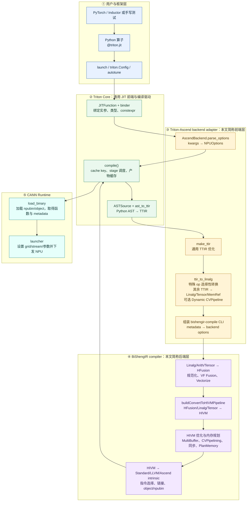
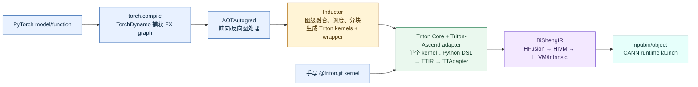
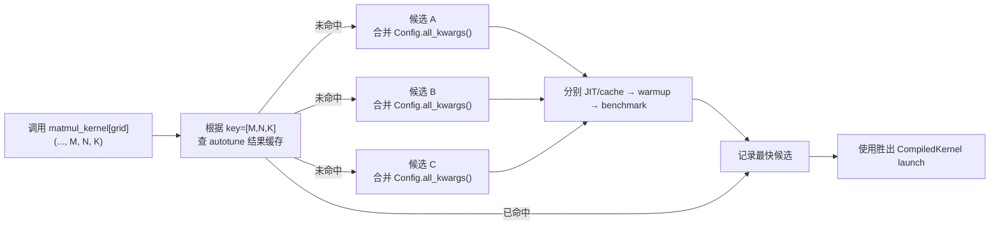
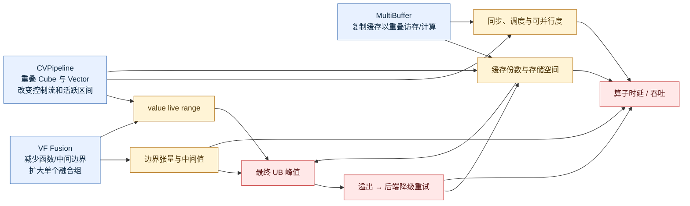

# Triton-Ascend 算子编译流程与 CVPipeline / MultiBuffer / VF Fusion 配置地图

> 代码基线：`triton-ascend` 官方 `main`，commit `1e1df856`（2026-08-05 检查）。  
> 重点平台：Ascend 910_95 / RegBase。文中“当前”均指上述代码基线。  
> 本文目标：说明一个 Triton 算子从 Python 到 NPU 二进制的完整过程，以及 CVPipeline、MultiBuffer、VF Fusion 的参数从哪里进入、在哪个 pass 被消费、怎样共同影响 UB。

## 1. 先给结论

这些配置不是在同一个阶段生效，而是沿编译链路分三层进入：

1. Python 调用层：在 `kernel[grid](...)` 或 `triton.Config(...)` 中设置。
2. Triton-Ascend 前端层：`NPUOptions` 解析配置；Dynamic CVPipeline 在 TTIR → TTAdapter/Linalg 阶段生效。
3. BiShengIR 后端层：VF Fusion、传统 CVPipelining、自动 MultiBuffer、PlanMemory 和 UB 溢出重试在 `bishengir-compile` 内生效。

最重要的交互关系是：

- `enable_dynamic_cv_pipeline=True` 时，前端会强制 `enable_mixed_cv=True`、`disable_auto_inject_block_sync=True`、`set_workspace_multibuffer=0`，因此走新的 Dynamic CVPipeline，并关闭后端旧 CVPipelining 所依赖的 workspace 流水深度。
- Dynamic CVPipeline 若不适用或执行失败，会恢复上述三个配置，让后端传统路径继续接管。
- VF Fusion 当前检测到 CV/Mix 结构（`TPartOfMix` 或 `scope::ScopeOp`）会直接跳过，因此 `enable_vf_fusion=True` 不等于本次一定发生 VF 融合。
- `num_stages` 在当前 Ascend 后端的自动 MultiBuffer 路径主要是开关语义：`1` 关闭，其他值开启；它不是通用的 N 级流水深度。
- UB-aware VF 估算的是 VF 调用边界的 caller-side 活跃张量，不包含之后 CVPipeline/MultiBuffer 扩张出的缓存副本，所以它是融合决策估算，不是最终 PlanMemory 峰值的完整预测。

## 2. 完整编译流程图

```mermaid
flowchart TD
  classDef entry fill:#e8f1ff,stroke:#3167b1,color:#102a43
  classDef frontend fill:#eaf8ee,stroke:#2f855a,color:#163d2a
  classDef dynamic fill:#fff4d6,stroke:#b7791f,color:#51380b
  classDef backend fill:#f3e8ff,stroke:#805ad5,color:#35245b
  classDef memory fill:#ffe8e8,stroke:#c53030,color:#5b1717
  classDef output fill:#e6fffb,stroke:#258b83,color:#153e3b
  classDef decision fill:#fff,stroke:#4a5568,color:#1a202c

  A["Python @triton.jit 算子<br/>运行时实参 + constexpr"]:::entry
  C["配置入口<br/>kernel[grid](...) 或 triton.Config(...)"]:::entry
  AT["可选 autotune<br/>逐个 Config 编译与实测"]:::entry
  P["JIT binder / AscendBackend.parse_options<br/>筛选并构造 NPUOptions"]:::frontend
  K{"内存/磁盘编译缓存命中？"}:::decision
  R["ASTSource.make_ir<br/>Python AST → TTIR"]:::frontend
  T["make_ttir<br/>inline / combine / canonicalize / CSE / LICM / unroll"]:::frontend
  L["ttir_to_linalg<br/>TTIR → 控制流结构化<br/>→ 特殊 Triton op 选择性转为 HIVM/HFusion/LLVM<br/>→ 其余 op 转为 Linalg/Tensor/MemRef<br/>→ TTAdapter（混合 dialect MLIR）"]:::frontend

  D{"enable_dynamic_cv_pipeline？"}:::decision
  DF["强制编译元数据<br/>enable_mixed_cv=True<br/>disable_auto_inject_block_sync=True<br/>set_workspace_multibuffer=0"]:::dynamic
  DP["Dynamic CVPipeline<br/>预检查 → 标准化 → 规划计算块 → 计算块优化<br/>→ 拆分数据流 → 依赖分析 → 多缓存分配<br/>→ 控制流条件 → 访存/计算分离 → 清理属性"]:::dynamic
  DR{"Dynamic CV 成功？"}:::decision
  FB["失败回退<br/>恢复 mixed_cv / block_sync / workspace_multibuffer"]:::dynamic

  BC{"use_bytecode？"}:::decision
  B1["triton-mlir-opt<br/>TTAdapter/Linalg → MLIR bytecode"]:::frontend
  B2["bishengir-opt<br/>bytecode → bcmlir 文本"]:::frontend
  CMD["Python 组装 bishengir-compile 命令<br/>NPUOptions/metadata → 后端 CLI options"]:::backend

  VF{"enable_vf_fusion<br/>且不是 CV/Mix case？"}:::decision
  VFP["VFFusionPass<br/>all-op / n-most-op / max-parallel / ub-aware-op"]:::backend
  VA["UB-aware 决策<br/>目标 UB 容量与对齐 → 边界张量估算<br/>→ lookahead → merge/split 比较"]:::backend
  HF["HFusion / vectorize / inline / bufferize 等后端变换"]:::backend

  MB{"enable-auto-multi-buffer？<br/>multibuffer && num_stages != 1"}:::decision
  MBP["MarkMultiBuffer<br/>标记 local/workspace load/store/fixpipe/ND2NZ 等"]:::backend
  OCV{"mixed_cv 且<br/>workspace_multibuffer > 1？"}:::decision
  OCVP["传统 HIVM CVPipelining<br/>unroll 深度 = workspace_multibuffer<br/>preload 可切到 skew 模式"]:::backend
  MEM["PlanMemory / storage align / buffer reuse / sync lowering<br/>得到真实 UB/L1/L0C 分配"]:::memory
  OV{"UB / L1 / L0C 溢出？"}:::decision
  RETRY["后端降级重试<br/>按溢出空间关闭对应 MultiBuffer<br/>→ 关闭全局 MultiBuffer<br/>→ 关闭 VF Fusion 等"]:::memory
  BIN["LLVM/AICore 后端与链接<br/>生成 npubin / object"]:::output
  CACHE["写入编译缓存<br/>各阶段 IR + metadata JSON + binary"]:::output
  RUN["CompiledKernel 加载并 launch<br/>autotune 时测时并选择最佳 Config"]:::output

  A --> P
  C --> AT
  AT --> P
  P --> K
  K -- "命中" --> RUN
  K -- "未命中" --> R --> T --> L --> D
  D -- "是" --> DF --> DP --> DR
  DR -- "成功" --> BC
  DR -- "失败/不适用" --> FB --> BC
  D -- "否" --> BC
  BC -- "是（默认）" --> B1 --> B2 --> CMD
  BC -- "否" --> CMD
  CMD --> VF
  VF -- "是" --> VFP
  VFP -- "ub-aware-op" --> VA --> HF
  VFP -- "其他模式" --> HF
  VF -- "否/被跳过" --> HF
  HF --> MB
  MB -- "是" --> MBP --> OCV
  MB -- "否" --> OCV
  OCV -- "是" --> OCVP --> MEM
  OCV -- "否" --> MEM
  MEM --> OV
  OV -- "是" --> RETRY --> MEM
  OV -- "否" --> BIN --> CACHE --> RUN
```



### 2.1 “Triton-Ascend 前端层”和“BiShengIR 后端层”是怎样划分的

这里的“前端层/后端层”是本文为了理解工程而采用的分层，不是仓库中两个正式的产品名称。更准确地说，整个系统由五层组成：



#### 截图中的 Inductor 是什么

**Inductor 是 PyTorch `torch.compile` 的图编译后端，不是 Triton-Ascend 的一种 IR，也不是 BiShengIR 的一个编译阶段。** 它位于 Triton 之上：先对一整张 PyTorch 计算图做融合、调度、分块和 kernel 边界选择，再生成 Triton kernel 与主机侧 wrapper；随后每个生成的 Triton kernel 才进入本文描述的 Triton-Ascend 编译链。



两条入口的区别是：

- `torch.compile(model)` 路径会经过 Dynamo、AOTAutograd 和 Inductor；Inductor 决定图级融合、生成几个 kernel，以及每个 kernel 的形状与调度候选。
- 手写 `@triton.jit` 并用 `kernel[grid](...)` 启动时，直接进入 Triton 编译器，不经过 Inductor。
- 因而截图里的“PyTorch / Inductor 或手写测试”表达的是**上游调用来源二选一**，不是说每个 Triton 算子都必须先经过 Inductor。

边界可以用两个文件快速定位：

- Triton Core 调用厂商 backend 的边界：`python/triton/compiler/compiler.py` 中的 `backend.parse_options()` 与 `backend.add_stages()`。
- Triton-Ascend 把 IR 交给 BiShengIR 的边界：`third_party/ascend/backend/compiler.py` 组装 `bishengir-compile kernel.ttadapter.mlir ... -o kernel` 并启动子进程。

因此：

- “Triton-Ascend 前端层”负责接入 Triton JIT、解释 Python 配置、把通用 TTIR 改写成 BiShengIR 能接收的 TTAdapter/Linalg MLIR，并决定 Dynamic CVPipeline。
- “BiShengIR 后端层”接收已经与 Ascend 语义接轨的 MLIR，完成融合、向量化、HIVM lowering、流水/多缓存、同步、真实内存规划和机器码生成。
- Dynamic CVPipeline 虽然是 C++ pass，但它由 Triton-Ascend adapter 在 `ttir_to_linalg()` 中调度，所以本文把它归在“前端层”；不能简单用 Python/C++ 来区分前后端。

### 2.2 从 Triton 代码开始，每一步的输入、输出和变化

| 步骤 | 执行位置 | 输入 | 输出 | 这一阶段改变了什么 |
|---:|---|---|---|---|
| 0 | 用户 Python | `@triton.jit` 函数、tensor/scalar 实参、constexpr、launch config | 尚未编译的 `JITFunction` 调用 | Python DSL 描述的是“每个 program instance 做什么”，还没有确定完整类型特化和目标芯片。 |
| 1 | `JITFunction.run()` / binder | 运行时实参和 kwargs | `signature`、`constexprs`、参数属性、初步 options | tensor 转成指针元素类型/地址空间，标量转成具体类型；constexpr 值进入特化；编译选项与 kernel 参数分流。 |
| 2 | `AscendBackend.parse_options()` | kwargs/options 字典 | `NPUOptions` | 只保留 `NPUOptions` 声明的编译字段，补 target arch；按芯片补 `compile_on_910_95` 和 `enable_dynamic_cv_pipeline`。 |
| 3 | Triton `compile()` | `ASTSource` + target + `NPUOptions` + 会使缓存失效的环境变量 | cache hash，或直接返回 `CompiledKernel` | source/signature/constexpr/options/CANN 版本等共同参与 cache key；缓存命中时后续编译全部跳过。 |
| 4 | `ASTSource.make_ir()` / `ast_to_ttir()` | Python AST、已特化 signature/constexpr、target/codegen hooks | TTIR `ModuleOp` | 执行 Python DSL 的静态展开与语义检查，把 `tl.load`、`tl.store`、`tl.arange`、算术、控制流等变成 `tt.*`/标准 MLIR op。 |
| 5 | `make_ttir()` | 初始 TTIR | 优化后的 `.ttir` | inline、combine、canonicalize、CSE、LICM、broadcast reorder、symbol DCE、loop unroll；主要仍保持 TTIR 层级。 |
| 6 | `ttir_to_linalg()` 前半 | 优化 TTIR | 混合 dialect 的过渡 MLIR | 控制流优化、structure/unstructure、离散 mask 访问转换和 annotation；随后三个 pass 只转换各自认识的特殊 op：同步 custom op → HIVM，少量 histogram/fp/mod/conv op → HFusion，inline asm → LLVM。这里是**选择性改写真实 op**，不是给全部 TTIR 贴“HIVM/HFusion/LLVM 标注”。 |
| 7 | `ttir_to_linalg()` 后半 | 混合 dialect 过渡 MLIR | `.ttadapter` 文本 | `triton_to_linalg` 把其余核心 tensor 计算落到 Linalg/Tensor/MemRef/SCF 等表示；文件仍可能混有 HFusion/HIVM/annotation/LLVM 等方言，因此 TTAdapter 是桥接格式，不是“纯 Linalg”，也不是完整 HIVM。 |
| 8 | 可选 Dynamic CV pass | `.ttadapter` module + Dynamic CV configs | 重构后的 `.ttadapter`，或失败时恢复原 module | 把 Cube/Vector 工作规划成计算块，拆数据流，分析跨/同核依赖，插入多缓存和控制条件，分离访存与计算；失败时事务式回滚。 |
| 9 | `triton-mlir-opt`（默认 `use_bytecode=True`） | `.ttadapter` 文本 | `.mlirbc` bytes | 主要是 MLIR 文本到 bytecode 的序列化，方便跨不同 MLIR 工具链传递；不是一次新的业务优化。 |
| 10 | `bishengir-opt` | `.mlirbc` bytes | `.bcmlir`/`kernel.mlir` 文本 | 由 BiShengIR 的 dialect registry 重新读取 bytecode 并输出文本，作为 `bishengir-compile` 输入；语义总体保持。 |
| 11 | Python `_parse_linalg_metadata()` | TTAdapter/BCMLIR 文本 | IR + metadata | 从 module 中提取 `mix_mode`、`parallel_mode`、kernel name、tensor kinds、bitcode 等；同时把 `NPUOptions` 翻译为 BiShengIR CLI。 |
| 12 | BiShengIR HFusion | Linalg/Tensor/Arith/HFusion 混合 IR | 规范化并向量化的 HFusion/Vector IR | 尽可能转为 HFusion；做 reshape/flatten/normalize；按 VF mode 进行 VFFusion；做 pre-vectorization fusion、AutoVectorize 和 VF outline/inlining。 |
| 13 | HFusion → HIVM | HFusion/Vector IR | HIVM IR | 将高层 tensor/vector 计算映射为更接近 Ascend 硬件的 Cube/Vector 计算、DMA/load/store、workspace 和 core 类型。 |
| 14 | HIVM pipeline | HIVM IR + CV/MultiBuffer/sync configs | 已确定调度、缓存、同步和地址空间的 HIVM/低层 IR | `MarkMultiBuffer`、传统 CVPipelining、同步求解与注入、bufferization、PlanMemory；这里才形成真实 UB/L1/L0C 分配与 live range。 |
| 15 | overflow retry | PlanMemory 或后端失败信息 | 更保守配置下重新生成的低层 IR | 按内存空间关闭 MultiBuffer，再关闭全局 MultiBuffer、VF Fusion 等；成功二进制可能已和请求配置不同。 |
| 16 | Lower to LLVM/Intrinsic + BiSheng | 低层 HIVM/Standard/Vector IR | LLVM dialect/LLVM IR、AICore object、最终 `npubin` bytes | 把 HIVM 转成标准/控制流/LLVM/Ascend intrinsic，完成指令选择、设备 bitcode 链接和目标码生成。 |
| 17 | Triton cache + `CompiledKernel` | binary + metadata + 中间产物 | 缓存组和可启动 kernel 对象 | 保存各 stage 文件与 JSON metadata；runtime 加载 binary，绑定函数句柄后按 grid/stream launch。 |

TTIR → TTAdapter 的关键 pass 顺序可简化为：

```text
TTIR
→ triton-control-flow-opt
→ [可选 auto-scheduling: dag-sync / dag-scope / dag-ssbuffer]
→ triton-to-structure
→ discrete-mask-access-conversion
→ triton-to-annotation
→ triton-to-unstructure
→ triton-to-hivm
→ triton-to-hfusion
→ triton-to-llvm（辅助/剩余语义）
→ bubble-up-operation
→ triton-to-structure
→ triton-to-linalg
→ [可选 Dynamic CVPipeline]
→ TTAdapter/Linalg MLIR
```

这里的名字看起来不是严格的“单向降级”，是因为 TTAdapter 是一个桥接层：同一个 module 在过渡期会混合多种 dialect。`triton-to-hivm`、`triton-to-hfusion` 和 `triton-to-llvm` 并非把整个 module 全量转换到对应方言，而是先选择性改写少数特殊 op；`triton-to-linalg` 再承接其余 Triton tensor 计算。

### 2.3 HIVM 真实在哪一步生成

图中原来的“HIVM/HFusion/LLVM 标注”不够准确，容易让人以为此处已经把完整 kernel 变成 HIVM。真实过程分成“前端少量引入”和“后端主体 lowering”两段：

| 阶段 | pass / pipeline | 实际转换范围 | 输出状态 |
|---|---|---|---|
| Triton-Ascend adapter | `triton-to-hivm` | 只把 `sync_block_all`、`sync_block_set`、`sync_block_wait` 这类 Ascend custom op 转成 `hivm.SyncBlock*` | TTAdapter 中可能首次出现少量 `hivm.*`，但 module 主体仍不是 HIVM |
| Triton-Ascend adapter | `triton-to-hfusion` / `triton-to-llvm` | 前者处理少量 histogram、类型转换、mod、conv1d 特殊模式；后者主要处理 elementwise inline asm | 与 Linalg/Tensor/MemRef 等混合的 TTAdapter |
| BiShengIR HIR pipeline | HFusion 规范化、VF Fusion、Vectorize | 将 Linalg/Arith/Tensor 高层计算组织为 HFusion/Vector 表示 | 尚未完成 HIVM lowering |
| **BiShengIR convert-to-HIVM** | **`buildConvertToHIVMPipeline()`** | **`HFusionToHIVM`、kernel args、`TensorToHIVM`、`ConvertToHIVMOp` 共同把计算、参数和 tensor 操作系统性降到 HIVM** | **kernel 主体成为 HIVM；这是“完整 HIVM 生成”的关键阶段** |
| BiShengIR HIVM pipelines | HIVM tensor/lower/final pipelines | MultiBuffer、CVPipelining、同步、bufferization、PlanMemory，再继续降到 Standard/LLVM/Ascend intrinsic | 可进行机器码生成的低层 IR |

所以回答“真实在哪一步生成 HIVM”：**少量 HIVM op 在 `ttir_to_linalg()` 中已经被提前引入；完整、系统性的 HIVM IR 是 `bishengir-compile` 内执行 `buildConvertToHIVMPipeline()` 时生成的。**

```mermaid
flowchart LR
  classDef adapter fill:#fff4d6,stroke:#b7791f,color:#51380b
  classDef bridge fill:#eaf8ee,stroke:#2f855a,color:#163d2a
  classDef backend fill:#f3e8ff,stroke:#805ad5,color:#35245b
  classDef low fill:#ffe8e8,stroke:#c53030,color:#5b1717

  T["优化 TTIR"]:::adapter
  S["特殊 op 选择性转换<br/>sync → HIVM<br/>少量 op → HFusion<br/>inline asm → LLVM"]:::adapter
  A["triton-to-linalg<br/>其余 TTIR → Linalg/Tensor/MemRef"]:::adapter
  X["TTAdapter<br/>混合 dialect MLIR"]:::bridge
  H["BiShengIR HIR<br/>Linalg/Tensor/Arith → HFusion/Vector"]:::backend
  C["buildConvertToHIVMPipeline<br/>HFusion/Linalg/Tensor → HIVM"]:::backend
  O["HIVM pipelines<br/>CVPipeline/MultiBuffer/sync/PlanMemory"]:::backend
  L["Standard/LLVM/Ascend intrinsic<br/>object / npubin"]:::low

  T --> S --> A --> X --> H --> C --> O --> L
```



### 图中两个容易混淆的“CVPipeline”

| 名称 | 所在阶段 | 开关/深度 | 说明 |
|---|---|---|---|
| Dynamic CVPipeline | Triton-Ascend 的 TTIR → TTAdapter 阶段 | `enable_dynamic_cv_pipeline`；缓存数由 `intra_cache_num` / `inter_cache_num` / `load_cache_num` 控制 | 910_95 默认开启；负责计算块规划、数据流拆分、多缓存和控制流重构。 |
| 传统 HIVM CVPipelining | `bishengir-compile` 后端 HIVM pipeline | `set_workspace_multibuffer` 是 unroll 模式深度；`enable_preload` 切 skew | 只有 mixed-CV 且深度大于 1 才真正做流水；Dynamic CV 成功时 workspace 深度被强制置 0，因此通常不会再走它。 |

## 3. Config 在哪里配置

### 3.1 单次 kernel launch

`kernel[grid](...)` 表示“使用这一组参数编译/取得 kernel，然后按 grid 启动”。一个完整的 vector-add 示例：

```python
import torch
import triton
import triton.language as tl


@triton.jit
def add_kernel(
    x_ptr, y_ptr, out_ptr, n_elements,
    BLOCK_SIZE: tl.constexpr,
):
    pid = tl.program_id(axis=0)
    offsets = pid * BLOCK_SIZE + tl.arange(0, BLOCK_SIZE)
    mask = offsets < n_elements
    x = tl.load(x_ptr + offsets, mask=mask)
    y = tl.load(y_ptr + offsets, mask=mask)
    tl.store(out_ptr + offsets, x + y, mask=mask)


def add(x, y):
    out = torch.empty_like(x)
    n_elements = out.numel()
    grid = (triton.cdiv(n_elements, 1024),)

    add_kernel[grid](
        x, y, out, n_elements,             # 运行时 kernel 参数
        BLOCK_SIZE=1024,                   # tl.constexpr：参与 AST/TTIR 特化

        # Triton 通用/Ascend backend 编译选项
        num_warps=32,
        num_stages=2,
        multibuffer=True,

        # Dynamic CVPipeline
        enable_dynamic_cv_pipeline=True,
        intra_cache_num=2,
        inter_cache_num=1,
        load_cache_num=1,

        # VF Fusion
        enable_vf_fusion=True,
        vf_fusion_mode="ub-aware-op",
        vf_merge_level=0,

        # 调试时建议显式打开
        debug=True,
    )
    return out
```

这个 vector-add 主要用于展示参数语法；它没有 Cube 计算，Dynamic CV 很可能预检查后回退。验证 CVPipeline 应使用包含 `tl.dot`/matmul 与 Vector 后处理的 mixed-CV kernel。

调用中的名字按以下规则分类：

| 写法 | 属于什么 | 去哪里 |
|---|---|---|
| `x, y, out, n_elements` | kernel 运行时参数 | 形成 signature，launch 时传给设备函数。不同类型/特化条件可能触发新编译。 |
| `BLOCK_SIZE=1024` | kernel 形参且声明为 `tl.constexpr` | 编译期常量，参与 Python AST 展开和 TTIR 生成，不作为普通运行时参数传入。 |
| `num_stages=2`、`multibuffer=True` 等 | 名字不在 kernel 形参中，但存在于 backend `NPUOptions` | 进入 `AscendBackend.parse_options()`，控制编译 pass 和后端 CLI。 |
| `grid` | launch 配置 | 决定启动多少个 Triton program instance；它不是 IR 优化开关。 |
| 未出现在 kernel 形参和 `NPUOptions` 的名字 | 非法参数 | `_pack_args()` 抛出 `KeyError: ... unrecognised`。 |

`kernel[grid]` 并不保证每次都重新编译：相同 source、signature、constexpr、target 和编译 options 通常命中 JIT/cache。调试编译选项时可用 `TRITON_ALWAYS_COMPILE=1`。

#### 三组直接 launch 的实验配置

新 Dynamic CV 路径：

```python
kernel[grid](
    *args,
    BLOCK_M=64, BLOCK_N=64,
    enable_dynamic_cv_pipeline=True,
    intra_cache_num=2,
    inter_cache_num=1,
    load_cache_num=1,
    multibuffer=True,
    num_stages=2,
)
```

传统 CV 路径，显式关闭 Dynamic CV，再控制 workspace 流水深度：

```python
kernel[grid](
    *args,
    BLOCK_M=64, BLOCK_N=64,
    enable_dynamic_cv_pipeline=False,
    enable_mixed_cv=True,
    set_workspace_multibuffer=4,
    enable_hivm_auto_cv_balance=True,
    tile_mix_vector_loop=2,
    tile_mix_cube_loop=2,
    multibuffer=True,
    num_stages=2,
)
```

VF/UB 对照路径：

```python
# 基线：enable_vf_fusion=False
# 实验：enable_vf_fusion=True, vf_fusion_mode="ub-aware-op"
kernel[grid](
    *args,
    BLOCK_SIZE=1024,
    enable_vf_fusion=True,
    vf_fusion_mode="ub-aware-op",
    vf_merge_level=0,
    multibuffer=False,
    num_stages=1,
)
```

最后一组先关闭 MultiBuffer，是为了单独观察 VF 对边界张量和基础 UB 的影响；随后再打开 MultiBuffer 才容易识别交互项。

### 3.2 `triton.Config` 与 autotune

`triton.Config` 不是另一套编译器配置系统。它只是把“一组 kernel meta-parameters + backend options”包装成 autotuner 的一个候选。autotuner 对每个候选调用同一个 `JITFunction.run()`，所以最终仍走 3.1 的解析链。

下面示例对比 Dynamic CV、新旧 CV 路径和 VF mode：

```python
AUTOTUNE_CONFIGS = [
    # 候选 A：Dynamic CV + UB-aware VF
    triton.Config(
        {
            "BLOCK_M": 64,
            "BLOCK_N": 64,
            "BLOCK_K": 32,
            "enable_dynamic_cv_pipeline": True,
            "intra_cache_num": 2,
            "inter_cache_num": 1,
            "load_cache_num": 1,
            "multibuffer": True,
            "enable_vf_fusion": True,
            "vf_fusion_mode": "ub-aware-op",
            "vf_merge_level": 0,
        },
        num_stages=2,
        num_warps=32,
    ),

    # 候选 B：传统 CV，workspace 流水深度 2
    triton.Config(
        {
            "BLOCK_M": 64,
            "BLOCK_N": 64,
            "BLOCK_K": 32,
            "enable_dynamic_cv_pipeline": False,
            "enable_mixed_cv": True,
            "set_workspace_multibuffer": 2,
            "enable_hivm_auto_cv_balance": True,
            "multibuffer": True,
            "enable_vf_fusion": True,
            "vf_fusion_mode": "max-parallel",
        },
        num_stages=2,
        num_warps=32,
    ),

    # 候选 C：关闭 CV、MultiBuffer、VF，作为资源/性能基线
    triton.Config(
        {
            "BLOCK_M": 64,
            "BLOCK_N": 64,
            "BLOCK_K": 32,
            "enable_dynamic_cv_pipeline": False,
            "enable_mixed_cv": False,
            "set_workspace_multibuffer": 0,
            "multibuffer": False,
            "enable_vf_fusion": False,
        },
        num_stages=1,
        num_warps=32,
    ),
]


@triton.autotune(
    configs=AUTOTUNE_CONFIGS,
    key=["M", "N", "K"],
)
@triton.jit
def matmul_kernel(
    a_ptr, b_ptr, c_ptr,
    M, N, K,
    BLOCK_M: tl.constexpr,
    BLOCK_N: tl.constexpr,
    BLOCK_K: tl.constexpr,
):
    ...
```

执行过程：



`Config.all_kwargs()` 的合并结果近似为：

```python
{
    **config.kwargs,
    "num_warps": config.num_warps,
    "num_ctas": config.num_ctas,
    "num_stages": config.num_stages,
    # 非 None 时还包括 maxnreg / ir_override
}
```

这些字段与 launch 时显式传入的 meta kwargs 合并，再由 binder 和 `AscendBackend.parse_options()` 分类。每个不同的编译 options 都参与 cache key，因此候选 A/B/C 通常产生不同 binary。

注意：

- 同一个 meta-parameter 不要同时在 launch kwargs 和 `Config.kwargs` 里定义，autotuner 会报 `Conflicting meta-parameters`。
- `key=["M", "N", "K"]` 决定“输入如何变化时重新选择最佳候选”，不是编译 pass 配置。
- autotune 的最佳结果只代表给定 shape/dtype/环境下的实测时延；它不会自动证明 UB 使用更少。
- 做建模时不要只保存 winner，应保存每个候选的请求配置、最终编译命令、UB、fallback/retry 和时延。

### 3.3 默认值在哪里定义

Python 可见的默认值集中在：

`third_party/ascend/backend/compiler.py` 的 `NPUOptions` dataclass。

其中当前关键默认值为：

| 配置 | Python 默认值 | 补充行为 |
|---|---:|---|
| `num_stages` | `2` | 在 Ascend 自动 MultiBuffer 路径中，`1` 表示关；其他值表示开。 |
| `multibuffer` | `True` | 与 `num_stages` 共同翻译为 `--enable-auto-multi-buffer`。 |
| `enable_dynamic_cv_pipeline` | `None` | `parse_options()` 中按芯片补值：910_95 为 `True`，其他平台为 `False`。 |
| `enable_vf_fusion` | `None` | 若不显式传，Python 不下发该 CLI；BiShengIR 自身有后端默认。做实验应显式设置。 |
| `vf_fusion_mode` | `None` | 若不显式传，使用后端默认模式；做可复现实验应显式设置。 |
| `vf_merge_level` | 实际为 `1` | dataclass 中重复声明过一次，后一个声明覆盖前一个。UB-aware 后端会强制按 level 0 处理。 |
| `enable_buffer_insert_optimization` | `True` | 仅 Dynamic CVPipeline 的多缓存插入会读取。 |
| `intra_cache_num` / `inter_cache_num` / `load_cache_num` | `None` | 未传时 Dynamic CV 内部默认分别为 2 / 1 / 1。 |
| `set_workspace_multibuffer` | `None` | Python 未传则后端默认是 4；Dynamic CV 成功路径会改成 0。 |

后端 CLI 的声明和默认值位于：

`third_party/ascend/AscendNPU-IR/bishengir/include/bishengir/Tools/bishengir-compile/Options.td`

## 4. 配置从入口到生效点的映射

### 4.1 Dynamic CVPipeline 参数

| Python 配置 | 生效位置 | 实际含义与限制 |
|---|---|---|
| `enable_dynamic_cv_pipeline` | `compiler.py::ttir_to_linalg()` → `add_dynamic_cv_pipeline()` | 总开关；910_95 默认开。运行前强制 mixed-CV、关闭自动 block sync 注入、关闭旧 workspace pipeline。 |
| `intra_cache_num` | `BufferCountManager(INTRA)` → `AddMultiBufferInnerScope` | 同核/内层缓存份数；默认 2；实现会按 N 分配缓存。`>=3` 会告警“不推荐”，不是禁止。 |
| `inter_cache_num` | `BufferCountManager(INTER)` → `AddMultiBufferOuterScope` | 跨核/外层缓存；默认 1。当前核心分支按 `>1` 判断是否 double buffer，因此 2、3、4 在该处并不是等价的 N 级外层流水。 |
| `load_cache_num` | `BufferCountManager(LOAD)` | 默认 1。完整的 GM load 解耦实现存在于 `DecoupleComputeAndMemory`，但当前 Dynamic CV 总 pipeline 未调度该 pass；已调度的 `SeparateMemoryFromCompute/MarkGMLoad` 又把向量/矩阵 load 缓存数固定为 1。因此当前默认链路中，这个参数基本没有形成期望的 N-buffer 效果。 |
| `enable_cube_block_merge` | `ComputeBlockOpt` | 允许 cube loader penetration 与 cube-for block merge；默认关。 |
| `enable_ub_refine_opt` | `ComputeBlockOpt/UBUsageOpt` | Dynamic CV 中的 UB 使用细化优化；默认关。 |
| `enable_buffer_insert_optimization` | `AddMultiBufferInnerScope` 读取 module attr | 避免在 `if` 中部重复 tensor compute；默认开。 |

Dynamic CV 的 pass 顺序是：

```text
PreCheckAvailable
→ StandardizeOp
→ PlanComputeBlock
→ ComputeBlockOpt
→ SplitDataflow
→ AnalyzeDataFlow
→ AllocMultiCache
→ AddControlFlowCondition
→ SeparateMemoryFromCompute
→ RemoveSsbufAttr
```

该 pipeline 会先备份 module。预检查不支持或任一关键步骤失败时，恢复原 module，并通过 module return-code 属性通知 Python；Python 随后把 `enable_dynamic_cv_pipeline` 改为 `False`，恢复旧配置继续编译。因此仅看 launch 配置不能确认生效，必须看 IR/日志。

### 4.2 传统 CVPipelining 及关联参数

| Python 配置 | 后端 CLI / pass | 作用 |
|---|---|---|
| `set_workspace_multibuffer=N` | `--set-workspace-multibuffer=N` → `CVPipeliningOptions.setDepthInUnrollMode` | 传统 CV unroll 流水深度和 workspace multibuffer 数。`0/1` 时 CVPipelining 直接返回。后端默认 4。 |
| `enable_preload=True` | `--enable-preload=true` | 把后端 `setCVPipelineMode` 强制切到 `skew`，并启用 preload 相关 pass。 |
| `enable_hivm_auto_cv_balance` | `--enable-hivm-auto-cv-balance` | CV pipelining 中的 Cube/Vector 平衡。 |
| `tile_mix_vector_loop` | `--tile-mix-vector-loop` | mixed kernel 的 vector loop tile trip count；后端默认 2。调优文档给出的候选通常是 2/4（合法候选还包括 8）。 |
| `tile_mix_cube_loop` | `--tile-mix-cube-loop` | mixed kernel 的 cube loop tile trip count；后端默认 2。调优文档给出的候选通常是 2/4（合法候选还包括 8）。 |
| `disable_auto_inject_block_sync` | `--disable-auto-inject-block-sync` | 控制后端自动 block sync 注入；Dynamic CV 会强制为 True。 |
| `sync_solver` / `unit_flag` | 对应 HIVM graph sync solver / unit flag CLI | 影响流水后的同步求解和同步实现，也会间接影响性能与指令/资源开销。 |

后端还定义了 `set-cv-pipeline-mode={off,unroll,skew,dynamic}` 和 `enable-lazy-loading`，但当前 `NPUOptions` 没有直接暴露这两个同名 Python 字段。普通 Python kernel 配置能直接控制的是上表字段；其中 `enable_preload=True` 会间接把模式切成 `skew`。

### 4.3 自动 MultiBuffer 参数

| Python 配置 | 翻译 | 生效与范围 |
|---|---|---|
| `multibuffer` + `num_stages` | `--enable-auto-multi-buffer=(multibuffer and num_stages != 1)` | 总开关。当前 Ascend 路径没有把 `num_stages=3/4` 直接翻译成 3/4 份自动缓存。 |
| `limit_auto_multi_buffer_only_for_local_buffer` | `--limit-auto-multi-buffer-only-for-local-buffer` | 限制只对 local buffer 做自动多缓存，避免 workspace 扩张。 |
| `limit_auto_multi_buffer_of_local_buffer` | `--limit-auto-multi-buffer-of-local-buffer={no-limit,no-l0c}` | 是否排除 L0C；910_95 Python 组装命令时未设置会显式使用 `no-limit`。 |
| `limit_auto_multi_buffer_buffer` | `--limit-auto-multi-buffer-buffer={no-limit,only-cube,only-vector}` | 限定对 Cube 或 Vector 相关 buffer 做多缓存。 |
| `set_workspace_multibuffer` | `--set-workspace-multibuffer=N` | workspace 多缓存数，同时也是传统 CV unroll 深度。 |

`MarkMultiBuffer` 会根据这些限制给 Scope、ND2NZ、Fixpipe、Load、Store 等操作打标，后续 bufferization/PlanMemory 才把标记变成真实缓存。也就是说，打开开关不等于所有 buffer 都会复制：是否匹配结构、存储空间、local/workspace 限制和后续合法性都影响结果。

发生内存溢出时，BiShengIR 有重试降级链：

1. UB 溢出：优先关闭 UB 上的 MultiBuffer。
2. L0C 溢出：关闭 L0C MultiBuffer。
3. L1/CBUF 溢出：关闭 L1 MultiBuffer。
4. 仍失败：关闭全局自动 MultiBuffer。
5. 再失败：关闭 VF Fusion，并继续其他后端保守策略。

所以最终成功生成的二进制可能已经不是用户最初要求的优化组合；研究建模时要同时记录“请求配置”和“最终 IR/重试结果”。

### 4.4 VF Fusion 参数

| Python 配置 | 后端生效点 | 说明 |
|---|---|---|
| `enable_vf_fusion` | `HFusionRegbasePipelines` → `VFFusionPass` | 总开关。但 `VFFusionPass` 遇到 CV/Mix case 会直接返回。 |
| `vf_fusion_mode="all-op"` | `AllOpKind` | 尽可能把所有可融合 op 放入组，通常最激进。 |
| `vf_fusion_mode="n-most-op"` | `NMostOpKind` | 按数量约束组织融合组。 |
| `vf_fusion_mode="max-parallel"` | `MaxParallelKind` | 以后端并行性为主要目标；后端默认模式。 |
| `vf_fusion_mode="ub-aware-op"` | `UBAwareOpKindAnalyzer` | 用目标 UB 容量做 caller-side 峰值估算，决定是否合并融合组。 |
| `vf_merge_level` | `--enable-vf-merge-level` | 0 不做额外 merge；1 在 bufferization 前 merge；2 在之后 merge。当前 Python 实际默认 1；UB-aware 会在后端强制为 0。 |
| `enable_auto_vectorize_v2` | 后续 HFusion/Vectorize | 控制自动向量化 v2，不是 VFFusion 本身，但会改变融合后结构与性能。 |
| `auto_vectorize_v2_max_fused_ops_num` | HFusion vectorize v2 | 限制 auto-vectorize-v2 融合 op 数；后端默认上限 15。 |
| `prevec_max_fused_ops_num` | pre-vectorization fusion | 限制预向量化 elementwise 融合数；后端默认 `-1` 表示不设上限。 |
| `hfusion_enable_multiple_consumer_fusion` | HFusion | 允许多 consumer 融合；Python 默认 False。 |
| `enable_cross_if_fusion` | HFusion | 允许跨 `if` 融合；Python 默认 False。 |

#### UB-aware 到底怎样估算

预算与对齐直接从目标芯片 spec 读取：

```text
ubBudgetBytes = UB_SIZE(bits) / 8
ubAlignBytes  = UB_ALIGN_SIZE(bits) / 8
```

候选融合组 X、Y 合并后的估算为：

```text
mergedBytes = Σ aligned(external inputs)
            + Σ aligned(external outputs except at most one reusable output)
```

步骤是：

1. 收集 X、Y 两个 Union-Find 组中的 op，并识别会被 hoist 的 `memref.alloc`、`tensor.empty` 等。
2. 外部输入：定义在组外、但被组内使用的 shaped value；hoisted 非空对象也按 caller-side 输入计入；`tensor.empty` 只作输出占位，不算真实输入。
3. 外部输出：组内结果被组外 op 使用时计入。
4. 模拟 PlanMemory 原地复用：最多允许一个输出复用一个已经死亡且类型/大小兼容的输入槽位。
5. 每个张量字节数按芯片 UB 对齐粒度向上对齐后求和。

决策顺序：

```text
mergedBytes <= UB budget
    → 允许融合
否则最多向下游 consumer lookahead 2 层
    → 若把边界输出内部化后能装下，则允许
否则计算 splitPeak = max(peakDuringX, peakDuringY)
    → 若 splitPeak > mergedBytes，仍允许合并（选择 UB 压力更小的一方）
否则拒绝融合，保留拆分
```

局限：动态 shape 的精确字节数无法静态得到时会低估；它估算 VF 调用边界，不计入后续 MultiBuffer/CVPipeline 的 N 份缓存、同步临时量及所有低层布局变化。因此建模时建议把它看成：

```text
最终 UB 峰值 ≈ VF 边界基础量
            + CV/MultiBuffer 扩张量
            + 对齐/临时量/同步量
            - PlanMemory 实际复用量
```

## 5. 三类优化如何共同影响 UB 与性能



典型权衡：

- VF 融合可消除边界 materialize/call 开销，但可能让更多输入同时活跃。
- CVPipeline 通过 Cube/Vector 重叠提高利用率，却会延长某些 value 的 live range。
- MultiBuffer 用更多 UB/L1/L0C 空间换取 load/store 与 compute 重叠。
- 三者同时打开时，不是三个独立的开关相乘；前一阶段改变的 IR 会决定后一阶段是否匹配、需要几份 buffer、是否发生溢出和降级。

## 6. 如何确认配置真的生效

推荐调试方式：

```bash
TRITON_DEBUG=1 \
TRITON_ALWAYS_COMPILE=1 \
TRITON_KERNEL_DUMP=1 \
TRITON_DUMP_DIR=/tmp/triton-ascend-dump \
MLIR_ENABLE_DUMP=1 \
ENABLE_PRINT_UB_BITS=1 \
TRITON_PRINT_AUTOTUNING=1 \
python your_case.py
```

各开关作用：

| 环境变量 | 用途 |
|---|---|
| `TRITON_ALWAYS_COMPILE=1` | 忽略已有 cache，确保本次配置真的重新编译；比删除整个 cache 安全。 |
| `TRITON_DEBUG=1` | 让 Ascend backend 保存 `kernel.ttir.mlir`、`kernel.ttadapter.mlir`，并打印可复现命令。 |
| `TRITON_KERNEL_DUMP=1` + `TRITON_DUMP_DIR` | 保存编译阶段产物到指定目录。 |
| `MLIR_ENABLE_DUMP=1` | 打印 MLIR pass 前后的 IR；也可设置为 kernel 名缩小范围。输出很大，批量实验不宜常开。 |
| `ENABLE_PRINT_UB_BITS=1` | 请求后端打印已分配内存大小，供 UB 使用量观测。 |
| `TRITON_PRINT_AUTOTUNING=1` | 输出 autotune 配置、命令及最佳配置。 |

验证点：

1. Python debug 输出的 `bishengir-compile` 命令中是否有预期 CLI，例如 `--enable-auto-multi-buffer`、`--vf-fusion-mode`、`--set-workspace-multibuffer`。
2. `kernel.ttadapter.mlir` 是否出现 Dynamic CV 生成的 scope/混合计算结构；是否存在失败回退 return code 日志。
3. 后端 pass dump 中是否实际执行 VFFusion；CV/Mix case 下应预期它被跳过。
4. MultiBuffer 标记是否最终变成了真实 buffer，而不仅是 option 为 True。
5. 是否出现 UB overflow retry；若有，记录最终被关闭的优化。
6. 用同一 shape、dtype、layout、多次 warmup 后测时；将编译时间与运行时间分开。

## 7. 建模实验建议

先用因子实验建立主效应，再增加交互项：

| 因子 | 建议档位 |
|---|---|
| Dynamic CV | off / on |
| 传统 CV 深度 | Dynamic CV off 时测 `set_workspace_multibuffer=1/2/4` |
| Dynamic intra cache | 1 / 2 / 3（3 会告警，适合研究不一定适合默认） |
| Dynamic inter cache | 1 / 2；当前 `>1` 主要表现为 double-buffer 开关 |
| Auto MultiBuffer | off / on |
| Local buffer 范围 | `no-l0c` / `no-limit` |
| Buffer 类型范围 | `only-cube` / `only-vector` / `no-limit` |
| VF Fusion | off / on |
| VF mode | `max-parallel` / `ub-aware-op`，必要时加入 `all-op` |
| VF merge level | 0 / 1 / 2；UB-aware 实验中记录后端强制 0 |
| Block tile | 固定一组基准，再测 `tile_mix_vector_loop`、`tile_mix_cube_loop` 的 2 / 4 |

每个样本至少记录：

```text
shape / dtype / strides / target
请求的完整 Config
实际 bishengir-compile 命令
Dynamic CV 成功或 fallback
VFFusion 是否执行、融合组数量/边界 bytes（若有日志）
最终 buffer 数、存储空间和 PlanMemory UB 峰值
是否发生 overflow retry 以及降级步骤
编译时间、kernel time、吞吐
IR hash / binary hash / commit
```

对当前目标，建议优先构造两套互斥基线：

- 新路径：`enable_dynamic_cv_pipeline=True`，扫 `intra_cache_num` / `inter_cache_num`，固定 `set_workspace_multibuffer=0`。
- 旧路径：`enable_dynamic_cv_pipeline=False`，扫 `set_workspace_multibuffer=1/2/4`，用来研究传统 CV 流水深度。

然后分别叠加 Auto MultiBuffer 与 VF Fusion。不要把 Dynamic CV 的 `intra_cache_num` 和传统 CV 的 `set_workspace_multibuffer` 当成同一个“流水深度”，它们作用的 IR 层次和缓存对象不同。

## 8. 关键源码索引

以下路径均相对于 `triton-ascend` 仓库根目录：

| 主题 | 文件 |
|---|---|
| JIT compile、cache key、各 stage 调度 | `python/triton/compiler/compiler.py` |
| launch kwargs 解析、JIT 内存缓存 | `python/triton/runtime/jit.py` |
| `triton.Config`、autotune 配置合并 | `python/triton/runtime/autotuner.py` |
| `NPUOptions`、TTIR/TTAdapter、CLI 命令组装 | `third_party/ascend/backend/compiler.py` |
| TTIR → HIVM 特殊同步 op | `third_party/ascend/lib/TritonToHIVM/TritonToHIVM.cpp` |
| TTIR → HFusion 特殊 op | `third_party/ascend/lib/TritonToHFusion/TritonToHFusion.cpp` |
| TTIR → LLVM inline asm | `third_party/ascend/lib/TritonToLLVM/TritonToLLVM.cpp` |
| Dynamic CV 总 pass | `third_party/ascend/lib/DynamicCVPipeline/AddDynamicCVPipeline.cpp` |
| Dynamic CV 缓存默认值 | `third_party/ascend/lib/DynamicCVPipeline/Common/BufferCountManager.cpp` |
| Dynamic intra cache | `third_party/ascend/lib/DynamicCVPipeline/AllocMultiCache/AddMultiBufferInnerScope.cpp` |
| Dynamic inter cache | `third_party/ascend/lib/DynamicCVPipeline/AllocMultiCache/AddMultiBufferOuterScope.cpp` |
| Dynamic load cache 实现 | `third_party/ascend/lib/DynamicCVPipeline/DecoupleComputeAndMemory.cpp` |
| BiShengIR CLI 默认值 | `third_party/ascend/AscendNPU-IR/bishengir/include/bishengir/Tools/bishengir-compile/Options.td` |
| 后端 option → HIVM pass options | `third_party/ascend/AscendNPU-IR/bishengir/lib/Tools/bishengir-compile/regbase/PassPipeline.cpp` |
| HFusion/Linalg/Tensor → HIVM 主体 pipeline | `third_party/ascend/AscendNPU-IR/bishengir/lib/Dialect/HIVM/Pipelines/regbase/HIVMRegbasePipelines.cpp` 中的 `buildConvertToHIVMPipeline()` |
| 传统 CVPipeline/MarkMultiBuffer 调度 | `third_party/ascend/AscendNPU-IR/bishengir/lib/Dialect/HIVM/Pipelines/regbase/HIVMRegbasePipelines.cpp` |
| 传统 CVPipeline 实现 | `third_party/ascend/AscendNPU-IR/bishengir/lib/Dialect/HIVM/Transforms/regbase/CVPipelining.cpp` |
| 自动 MultiBuffer 标记 | `third_party/ascend/AscendNPU-IR/bishengir/lib/Dialect/HIVM/Transforms/MarkMultiBuffer.cpp` |
| VF Fusion 入口和 CV bypass | `third_party/ascend/AscendNPU-IR/bishengir/lib/Dialect/Analysis/VFFusion/VFFusionPass.cpp` |
| UB-aware 估算器 | `third_party/ascend/AscendNPU-IR/bishengir/lib/Dialect/Analysis/VFFusion/VFFusionAnalyzer/UBAwareOpKindAnalyzer.cpp` |
| UB/L1/L0C 溢出重试 | `third_party/ascend/AscendNPU-IR/bishengir/lib/Tools/bishengir-compile/regbase/BiShengIRCompileMain.cpp` |
| 官方 max-autotune 候选档位 | `docs/en/max_autotune_guide.md` |
| dump/调试环境变量 | `docs/zh/debug_guide/debugging.md`、`docs/zh/environment_variable_and_compiler_options_reference.md` |

## 9. 一句话心智模型

```text
Config 决定编译 cache 和 pass 开关
→ Dynamic CV 先改变计算块、数据流和缓存结构
→ VF/传统 CV/MultiBuffer 在后端继续改变边界、活跃区间和缓存份数
→ PlanMemory 才给出真实 UB 分配
→ 溢出会触发降级重试
→ 最终二进制与性能必须以 IR、命令和后端日志确认，而不能只看 Python 配置值
```
