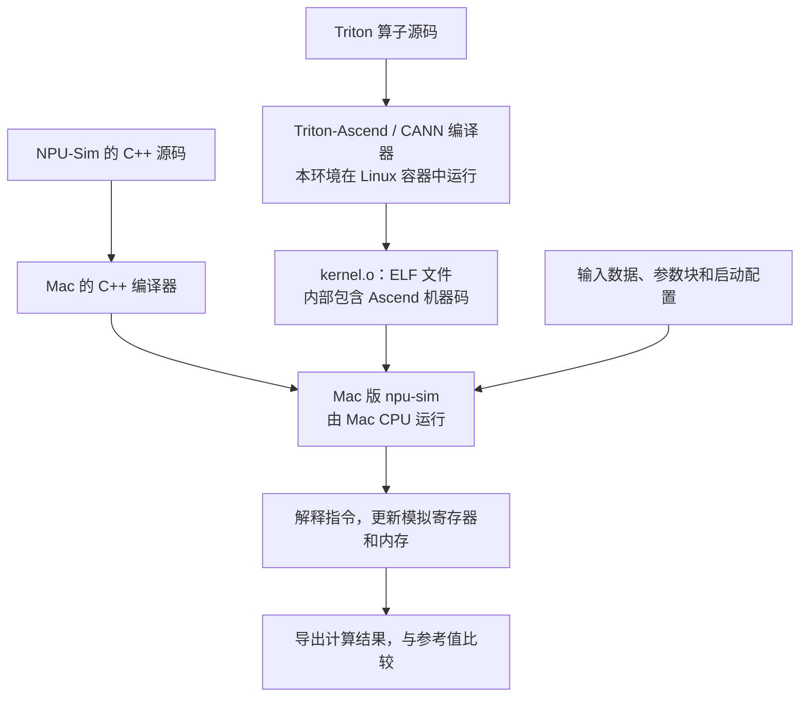

# ELF、ISA 与 NPU-Sim：Ascend 算子如何在 Mac 上执行

整理日期：2026-10-16。面向刚接触算子编译和仿真的读者。

本文区分通用概念、NPU-Sim 本地源码事实和文件检查观测；示意指令用于解释机制，不代表真实 Ascend 指令编码。

## 1. 先分清四件事

| 概念 | 回答的问题 | 在本项目中的例子 |
| --- | --- | --- |
| ELF（Executable and Linkable Format，可执行与可链接格式） | 编译出的代码和相关信息怎样保存在文件里？ | `kernel.o` 保存 Ascend 机器码及相关信息 |
| ISA（Instruction Set Architecture，指令集架构） | 每条机器指令怎样编码、执行后产生什么效果？ | Ascend 的加法、搬运、向量、矩阵和同步指令 |
| ABI（Application Binary Interface，应用二进制接口） | 编译后的不同部分怎样交接参数和数据？ | 启动器把输入地址和尺寸放在参数块的约定位置 |
| NPU-Sim | 谁来解释这些 Ascend 指令、维护执行状态？ | 在 Mac CPU 上运行的 C++ 功能解释器 |

ELF 负责组织文件，ISA 定义机器指令，参数 ABI 定义调用约定，NPU-Sim 实现其中一部分指令的执行逻辑。

## 2. ELF 文件到底是什么？

### 2.1 为什么编译后还需要一种文件格式？

编译器生成机器码后，使用者还需要知道：代码在哪里、数据在哪里、函数叫什么、各部分有多长，以及哪些地址需要在加载或链接时处理。ELF 用统一的结构保存这些信息。

ELF 是二进制文件格式。常见用途包括保存可重定位目标文件、可执行文件和共享对象；因此，名字里包含 Executable，不意味着每个 ELF 都能直接作为独立程序启动。见 [ELF 规范：Introduction](https://gabi.xinuos.com/elf/01-intro.html)。

本项目中的 `kernel.o` 是算子的设备编译产物。运行它还需要合适的加载器、参数和执行环境。

### 2.2 文件里面通常有什么？

下面是为了理解而简化的组织示意，实际顺序和是否存在这些部分取决于文件。

```text
kernel.o（ELF 文件）
├── ELF Header：文件类型、目标机器标识、各张表的位置等
├── .text：编译后的机器指令
├── .data / .rodata：数据或只读常量
├── 符号表：函数或变量名称及其对应位置等
├── 重定位信息：链接或加载时需要处理的位置，如存在
└── 设备专用元数据：由工具链扩展，例如内核相关信息
```

Section（节）是组织代码、数据等内容的单位；节头表帮助工具定位这些节。通用 ELF 可执行文件还会使用 Program Header 描述加载所需的信息。理解本项目时，先掌握“文件里既有指令，也有帮助定位和解释指令的信息”即可。见 [ELF 规范：Sections](https://gabi.xinuos.com/elf/03-sheader.html) 和 [Program Loading](https://gabi.xinuos.com/elf/07-pheader.html)。

### 2.3 ELF、文件后缀和芯片型号有什么关系？

ELF 是文件格式，里面的机器码仍然面向特定处理器。同样采用 ELF 格式的两个文件，可能分别装着 x86、Arm 或其他架构的机器码，不能因此相互替代。

`ELF64` 表示采用 ELF 的 64 位文件结构，并不表示“x86_64 指令”。目标机器标识由 ELF Header 的 `e_machine` 等信息描述。`.o` 是常见目标文件后缀，识别文件应检查实际内容。见 [ELF 规范：ELF Header](https://gabi.xinuos.com/elf/02-eheader.html)。

## 3. ISA 在这里指什么？

ISA 定义处理器能理解的机器指令，以及程序可见的执行规则。例如，一条指令哪些位表示操作类型、哪些位选择寄存器，以及加法、跳转或访存会如何改变状态。

这里讨论的是 Ascend NPU 的指令集；NPU-Sim 面向 Ascend 950PR，覆盖经过验证的部分编码和语义。Ascend 不同代际的支持情况需要分别确认，不能把某个子集的支持推广到所有芯片和所有算子。

可以把关系理解为：**ELF 里存着指令的机器编码，ISA 规定这些编码是什么意思，执行器据此更新状态。**

## 4. Ascend 指令为什么能在 Mac 上执行？

### 4.1 同时存在两份不同用途的程序

| 文件 | 面向谁 | 在这条执行链路中的用途 |
| --- | --- | --- |
| `kernel.o` | Ascend NPU | 作为输入，被 NPU-Sim 读取和解释 |
| Mac 版 `npu-sim` | Mac 的 Arm CPU | 作为普通 macOS 程序运行，完成解释工作 |

Mac CPU 执行的是 `npu-sim` 自己的宿主指令。Ascend 指令在这里是被读取、分析的数据，每条指令对应的效果由 C++ 代码算出来。

### 4.2 编译和执行是两个阶段



容器在这套环境里提供 Linux 编译工具链。获得已编译 ELF 后，独立执行路径可以由 Mac 版 NPU-Sim 完成；这一阶段不需要 CANN、Docker 或 NPU 卡。若使用 Linux 版执行器，则在对应的 Linux 环境中运行，解释指令的原理相同。

### 4.3 一个加法例子

假设某条指令的含义用下面的示意汇编表示：

```text
ADD R3, R1, R2
```

意思是：读取 R1 和 R2，把相加结果写入 R3。寄存器可以先理解为芯片内部保存数值的小格子。

假设执行前 R1 是 2、R2 是 3，模拟器的处理逻辑相当于：

```cpp
// 解释机制的伪代码，不是完整实现。
registers[3] = registers[1] + registers[2];
pc = next_instruction_address;
```

执行后，模拟的 R3 变成 5。这里的加法由 Mac CPU 执行，结果用于更新模拟的 NPU 状态。

`pc` 是 Program Counter（程序计数器），记录接下来取哪条指令。普通指令完成后继续向后取指；跳转指令会改变下一条指令的位置。

矩阵指令也遵循同一原则：NPU-Sim 读取指定的矩阵数据，运行软件计算逻辑，将结果写入模拟存储。一条设备指令可能需要很多条宿主 CPU 指令来完成。

### 4.4 “虚拟 NPU”由哪些状态组成？

| 被模拟的对象 | 软件中的表示与处理 |
| --- | --- |
| 寄存器 | 变量或数组，保存当前数值 |
| PC | 保存当前指令位置的数值 |
| GM、L1、L0A/L0B/L0C、UB 等存储区域 | Mac 内存中的缓冲区及地址映射，检查容量、边界和初始化状态 |
| 数据搬运 | 按指令描述在相应缓冲区之间读取和写入 |
| 向量、矩阵计算 | 对应的软件计算逻辑及数值模型 |
| 多核与同步 | 保存各核上下文，通过调度和事件状态处理等待、通知等行为 |

这些状态构成用于执行算子的功能模型。配置里写的设备存储容量是模拟约束，不会让 Mac 获得对应容量的物理 HBM。

## 5. 参数 ABI 和 ISA 缺口为什么是两层问题？

参数 ABI 是 ABI 在内核调用参数上的具体体现。例如调用者和内核必须约定：Q、K、V、输出地址、序列长度分别放在哪里，每项多宽、怎样对齐，以及隐藏参数占用哪些位置。

对话中“算子需要 144 字节参数块，而执行器按 64 字节处理”是 ABI 不匹配的例子。这里的 64 和 144 是该调用的参数块大小，与 `ELF64` 或 CPU 位数属于不同概念。这个例子用于解释问题层次，不表示当前源码仍处于同一状态，也不是所有算子都使用这两种长度。

适配参数后，执行器还必须认识实际执行路径上的指令：

| 问题所在层 | 可能出现的现象 | 需要解决什么 |
| --- | --- | --- |
| ELF 装载 | 文件头、节或支持的重定位信息不符合要求 | 正确解析文件并准备代码、数据 |
| 参数 ABI | 参数长度不符，或者读到错误地址、尺寸 | 按该编译产物的约定传参 |
| ISA 覆盖 | 遇到未知指令，或不支持的数据类型、尺寸、描述符 | 实现并验证对应指令语义 |
| 数值验证 | 程序结束，但输出与参考值不符 | 检查计算、数据布局、输入及容差依据 |

例如，已支持某条搬运指令的一种尺寸，不一定支持它的所有配置；已支持 FP16 矩阵计算，也不意味着已支持 BF16。这两类都可能表现为 ISA 覆盖不足。

## 6. 怎样看待“能跑”和“验证通过”？

下面每一步能证明的事情不同：

1. **编译成功**：编译器为给定源码和配置产出了设备机器码。
2. **ELF 检查成功**：检查器能够解析所需文件结构。
3. **参数与启动准备成功**：调用满足执行器要求，输入已映射。
4. **指令执行完成**：实际路径没有因未知指令、非法访问或死锁等检查而中断。
5. **数值比较通过**：在指定输入和容差下，输出符合参考结果。

其中任何一步都不能自动替代后面的检查。有限输入下数值比较通过，也不能推广成所有输入均正确或与真实芯片逐位一致。

NPU-Sim 的定位是**指令级功能解释器**。宿主耗时受指令解释、CPU、调度和日志等因素影响，不能作为真实 NPU 时延或吞吐量。参考答案只用于比较，不能代替机器码执行来生成算子输出。

## 7. 可以只读查看的文件与命令

在 `/Users/sky/Code/NPU-Sim` 中，已构建好执行器时可以查看：

```bash
# 查看宿主执行器和设备文件的格式，不执行算子。
file build/npu-sim
file tests/fixtures/matmul16.o

# 查看设备 ELF 的头部摘要、节和符号信息，不执行算子。
./build/npu-sim inspect tests/fixtures/matmul16.o
```

本次只读检查观测到：

```text
build/npu-sim: Mach-O 64-bit executable arm64
tests/fixtures/matmul16.o: ELF 64-bit LSB relocatable, *unknown arch 0x1029* version 1 (SYSV), not stripped
```

第一行说明本地执行器是 Mac 的 Arm64 可执行文件；第二行说明设备输入采用 ELF 格式。`file` 显示 `unknown arch` 表示该工具未识别这个机器标识，不能仅凭此判定文件损坏。这些观测只检查文件属性，没有执行算子。

进一步阅读：

- [Triton-Ascend 算子编译流程与配置地图](../Operator/compile/triton-ascend-operator-compilation-and-configs.md)：理解源码如何生成设备二进制。
- [探针：用小实验验证局部行为](../Testing/探针：用小实验验证局部行为.md)：理解怎样收集指令语义和验证证据。

## 8. 来源、版本与证据边界

通用 ELF 概念依据文中链接的 ELF Object File Format 规范，访问日期为 2026-10-16。

NPU-Sim 相关描述来自本地工作副本 `/Users/sky/Code/NPU-Sim` 的静态阅读：

- [README.md](/Users/sky/Code/NPU-Sim/README.md)：功能解释器定位、独立执行依赖和实现边界。
- [SOURCE_PACKAGE_GUIDE.md](/Users/sky/Code/NPU-Sim/docs/SOURCE_PACKAGE_GUIDE.md)：ELF 到解释执行的链路、多核调度及结果写回机制。
- [elf.cpp](/Users/sky/Code/NPU-Sim/src/elf.cpp)：读取文件、检查 ELF64 小端格式、解析节和符号。
- [executor.cpp](/Users/sky/Code/NPU-Sim/src/executor.cpp)：指令解码和加法等执行语义。
- [main.cpp](/Users/sky/Code/NPU-Sim/src/main.cpp)：独立运行与 `inspect` 入口。

本地目录为源码包，未取得 Git revision；源码和指南标识为 v0.6.0，不能据此认为工作副本与某个发布标签完全一致。读取时两个关键源码文件的 SHA256 如下，用于识别本次阅读基线，后续编辑可能改变它们：

```text
src/elf.cpp       0d591bedee1052ab5c19878ea5e73b35ac191223a30037e081e1e300a72aa8a2
src/executor.cpp  c9e0ff28b40d3257be3f5755c22b1973384379e396dae162945cdc442488f0c4
```

本文是概念整理、静态阅读和文件属性检查记录，没有新增算子端到端测试、官方模型运行或真机性能测试，也不把已有文档中的历史验收作为本次数值验证结果。
