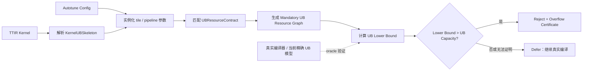

“二阶段 UB 下界模型”不是预测最终 UB 精确值，而是计算一个有数学保证的最低占用量：

> 无论后续编译器怎样做 alias、inplace、buffer 复用和地址规划，这个 config 至少需要这么多 UB。

记为：

```text
UB_lower_bound(config) ≤ 真实最终 UB peak(config)
```

只有当：

```text
UB_lower_bound > UB_capacity
```

才能证明该 config 必然 overflow，从而在 autotune 阶段安全过滤。

## 1. 为什么叫“解析/规则模型”

“解析”表示它不执行完整 TTIR→HFusion→HIVM→PlanMemory 流水线，而是从 TTIR 和 config 中直接提取：

- tensor shape；
- dtype；
- tile/block 大小；
- load/store；
- producer-consumer 关系；
- reduction/dot 轴；
- pipeline stage 等配置。

“规则”表示每类 operation 有一份经过证明的 UB 资源合同，例如：

```text
某类 vector add：
执行 add 时，两个输入 tile 必须同时存在于 UB；
output 可能与某个 input inplace，因此不能确定为第三块独立空间。
```

于是可以推导：

```text
LB(add) = size(input0_tile) + size(input1_tile)
```

它不用真的生成 `hivm.vadd`、`memref.alloc` 和完整 loop IR。

## 2. 整体流程



一个 kernel 的结构只解析一次；autotune 枚举的每个 config 只需要重新实例化 tile 大小并执行公式，成本会比完整 lowering 低很多。

## 3. 下界是怎样推导出来的

### 3.1 单个不可拆分 buffer 下界

如果某个 config 必然产生一个大小为 300 KB 的 UB tile，而芯片 UB 容量只有 256 KB：

```text
LB ≥ 300 KB > 256 KB
```

不需要分析 lifetime、inplace 或 PlanMemory，就可以直接过滤。

这是最简单、最可靠的一类规则。

### 3.2 必须共存的工作集

假设一个 vector add 的 tile 是 2048 个 `f32`：

```text
input_x = 2048 × 4 B = 8 KB
input_y = 2048 × 4 B = 8 KB
output  = 2048 × 4 B = 8 KB
```

执行 add 时，x 和 y 必须同时存在，所以：

```text
LB ≥ 8 KB + 8 KB = 16 KB
```

output 可能复用 x 或 y，因此为了保证下界安全，暂时不加 output：

```text
错误的激进估计：24 KB
安全的下界：    16 KB
```

真实编译结果可以是 16、24、32 KB，但不能小于已经证明的 16 KB。

### 3.3 强制 scratch

某些 reduction、sort、transpose 或特殊 HIVM operation 必须分配 scratch。

只有当 lowering 合同明确保证 scratch 一定存在时，才能加入下界：

```text
LB ≥ input_tile + mandatory_scratch
```

如果 scratch 的存在、地址空间或大小依赖后续 pattern，就不加入，返回较弱下界或 `defer`。

### 3.4 强制 multi-buffer

如果某种 pipeline 配置能够证明某 buffer 必然双缓冲：

```text
minimum_instances = 2
LB contribution = aligned_size × 2
```

如果不确定真实 `MarkMultiBuffer` 是否会标记，则必须用：

```text
minimum_instances = 1
```

不能用“通常是双缓冲”作为过滤依据。

## 4. UBResourceContract 是核心

二阶段不需要普通的：

```text
tt.add → hivm.vadd
```

而需要资源语义合同：

```cpp
struct UBResourceContract {
  // 规则适用于哪些 TTIR 形态和 config
  Applicability applicability;

  // 必然物化到 UB 的资源
  std::vector<MandatoryBuffer> buffers;

  // 必然存在的临时空间
  SymbolicSize mandatoryScratch;

  // 哪些资源必须同时存活
  std::vector<MustCoexistSet> coexistence;

  // 哪些资源绝对不能 alias
  std::vector<MustBeDistinct> distinctness;

  // 最低实例数量，例如确定的双缓冲
  SymbolicUInt minimumInstances;
};
```

其中 `SymbolicSize` 可以是 config 的表达式：

```text
tile_elements × dtype_bits
ceil_div(reduction_size, vector_width) × accumulator_bits
align_up(tile_bytes, mandatory_alignment)
```

每条合同还要携带：

- 适用的 target；
- 适用的编译器版本；
- 对应真实 lowering pattern；
- 为什么它构成下界；
- 不适用时怎样退化为 `defer`。

## 5. Mandatory UB Resource Graph

匹配规则后，不直接把所有 buffer 相加，而是构造资源图。

每个资源节点包括：

```text
资源来源：哪个 TTIR operation
最小大小：minimum extent
地址空间：必须是 UB，还是未知
最低实例数：1、2……
物化条件：是否一定形成物理 buffer
```

边表示：

```text
must-coexist：必须同时存活
must-distinct：不能使用同一物理存储
dependency：生产消费顺序
```

只有一组资源同时满足：

1. 必然物化到 UB；
2. 必须同时存活；
3. 两两不能 alias；

才能安全求和：

```text
LB_witness = Σ aligned_minimum_size(resource)
LB = max(all witnesses)
```

这里的 `witness` 就是“下界证明”。

## 6. 不确定情况怎样处理

保守模型最重要的不是多算，而是正确地少算：

| 不确定性 | 安全处理 |
|---|---|
| 不确定 value 是否物化成 UB buffer | 不计入 |
| 不确定属于 UB、L1 还是寄存器 | 不计入 |
| 不确定两个 value 能否 alias | 假设可以 alias |
| 不确定能否 inplace | 假设可以 inplace |
| 不确定 multi-buffer 数量 | 使用 1 |
| 不确定 scratch 是否存在 | 不计入 |
| 动态 shape 没有确定下界 | `defer` |
| 未支持的 TTIR operation | `defer` |
| 一个 op 有多种可能 lowering | 取所有 lowering 的最小资源需求 |
| 编译器版本与规则版本不匹配 | 禁用规则并 `defer` |

因此结果只有两个正式决策：

```text
reject：已经证明必然 overflow
defer：无法证明，继续真实编译
```

不应输出“accept”，因为下界没有超容量并不能证明实际编译一定成功。

## 7. 输出结果应该可解释

建议输出类似：

```json
{
  "decision": "reject",
  "lower_bound_bits": 2359296,
  "capacity_bits": 2097152,
  "lower_bound_utilization": 1.125,
  "certificate": {
    "rule": "reduction-input-and-scratch-coexist-v1",
    "operation": "%42 = tt.reduce",
    "config": {
      "tile_m": 128,
      "tile_n": 4096
    },
    "resources": [
      {
        "name": "input_tile",
        "minimum_bits": 2097152
      },
      {
        "name": "mandatory_reduce_scratch",
        "minimum_bits": 262144
      }
    ]
  }
}
```

无法证明时：

```json
{
  "decision": "defer",
  "lower_bound_bits": 131072,
  "capacity_bits": 2097152,
  "reason": "dynamic gather lowering is not covered"
}
```

`lower_bound_utilization` 只是最低利用率，不是最终 UB 利用率。

## 8. 它与当前 UB 模型的区别

| 当前精确模型 | 二阶段下界模型 |
|---|---|
| 输入是 CVPipelining 前 Generic/HIVM 相关 IR | 输入是 autotune 阶段 TTIR + config |
| 重放 UB 相关 pass | 不运行 pass，只应用资源规则 |
| 目标是得到最终 peak/offset | 目标是证明最低 peak |
| 需要 alias、lifetime、PlanMemory 等价 | 不确定时假设最大复用 |
| Exact 或 blocker | Reject 或 defer |
| 维护成本较高 | 规则范围较小、可逐步扩展 |
| 用于报告 UB 利用率 | 用于早期过滤必然 overflow config |

当前模型最适合作为下界模型的 oracle：

```text
对每个 TTIR + config：

lower_bound ≤ actual_peak
```

如果发现：

```text
lower_bound > actual_peak
```

对应规则立即失效，因为它已经不是安全下界。

不过 corpus 验证只能发现问题，不能代替规则本身的下界证明。

## 9. 建议分四级演进

### Level 0：单 buffer 下界

只检查：

```text
某个必然 UB buffer 的最小尺寸 > UB 容量
```

能力弱，但最容易证明安全。

### Level 1：operation 局部工作集

支持：

- elementwise 两输入共存；
- load/store 必然物化的 tile；
- 简单 reduction；
- 已知 mandatory scratch。

这是最适合首版 POC 的范围。

### Level 2：schedule-aware 下界

加入：

- loop tile；
- pipeline stage；
- 确定的 multi-buffer；
- config 控制的 alignment；
- reduction 分块。

### Level 3：跨 operation 全局下界

分析：

- producer-consumer DAG；
- 跨 operation 的必须存活关系；
- 必然不同的 alias class；
- 循环携带资源。

到这一层过滤率会提高，但也更接近程序分析，需要严格控制复杂度，避免重新发展成 TTIR→HIVM 影子编译器。

## 10. 判断这个方案是否成功

建议重点统计四个指标：

```text
false_reject_count = 0
```

这是硬门槛。

```text
overflow_filter_rate =
被安全过滤的真实 overflow config / 全部真实 overflow config
```

衡量过滤能力。

```text
defer_rate =
无法判断的 config / 全部 config
```

衡量覆盖率。

```text
analysis_cost / real_compile_cost
```

衡量是否真的值得放入 autotune 热路径。

最初即使只过滤 20% 的 overflow config，只要零误杀且分析成本很低，也有实际价值。

一句话概括：

> 二阶段模型不尝试猜出最终 UB peak，而是寻找一个或多个不可逃避的 UB 工作集；只要其中任何一个已经超过容量，就携带证明过滤该 config，其余情况全部交回真实编译器。